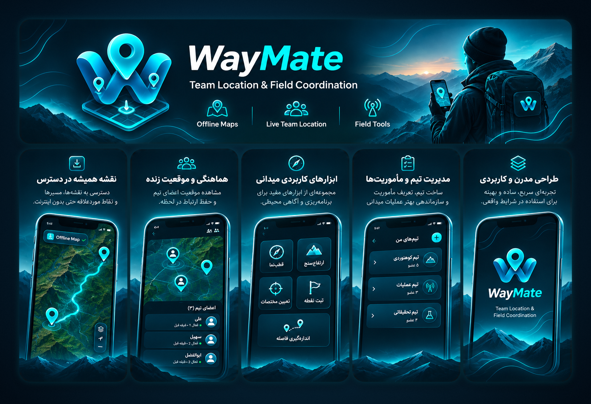
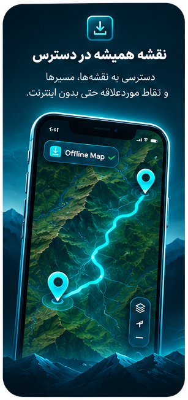
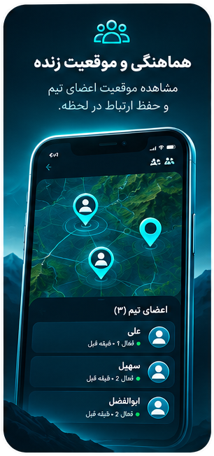
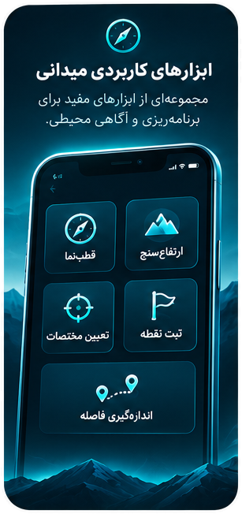
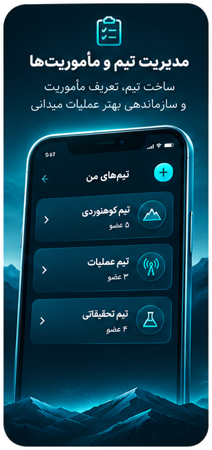
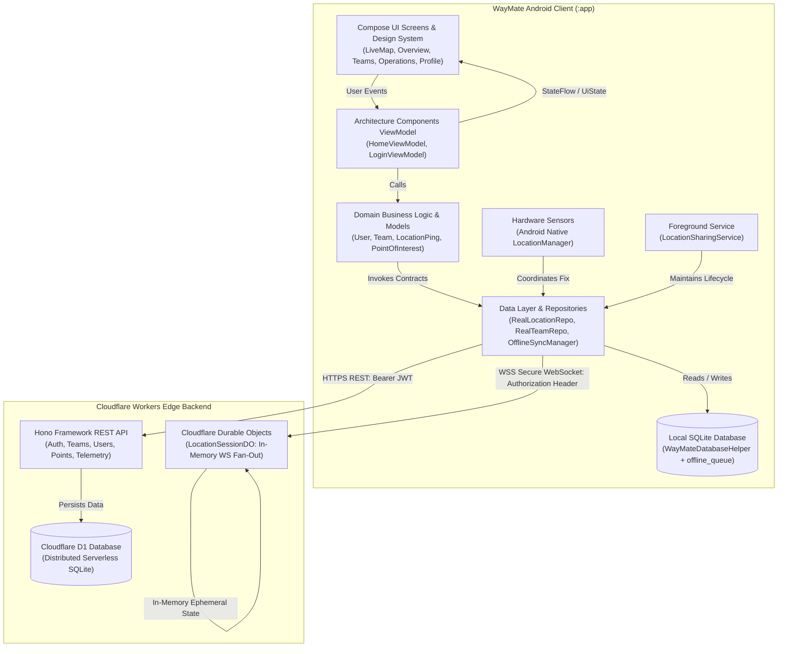

# WayMate

<div align="center">


**Tactical Offline GIS Mapping, Real-Time Team Awareness & Field Operations Coordination**

[-3DDC84.svg?style=flat&logo=android)](https://www.android.com/)
[](https://kotlinlang.org/)
[](https://developer.android.com/jetpack/compose)
[](https://workers.cloudflare.com/)
[]()
[]()
[]()

</div>

---

## 1. Project Identity & Philosophy

**WayMate** is an offline-first tactical coordination, field navigation, and operational awareness Android application tailored for expedition groups, search-and-rescue squads, and field patrol units.

Designed with a high-contrast **Persian RTL (Right-to-Left) dark tactical interface**, WayMate bridges field ergonomics with robust architectural principles:

- **Zero Vendor Lock-In:** Independent of Google Play Services; location positioning uses native Android hardware providers (`GPS_PROVIDER` and `NETWORK_PROVIDER`).
- **Offline-First by Design:** Critical trail navigation, 5,400+ vector GIS geometries, and waypoint management remain 100% operational in remote mountain terrains with zero cellular coverage.
- **Explicit Consent & Privacy:** Location tracking requires explicit user opt-in, runs under a visible foreground service with immediate stop controls, and purges telemetry upon session termination.
- **Resilient Edge Synchronization:** Outgoing actions buffer in local SQLite queues and drain deterministically to a Cloudflare Workers serverless backend upon network reconnection.

---

## 2. Product Overview

WayMate coordinates multi-tiered operational workflows between field units and central command:

```text
[ Field Operators & Scouts ]                [ Command & Coordination Hub ]
           │                                                │
           ├─► Tactical Map & Offline GIS                   ├─► Multi-Unit Team Roster
           ├─► Route Simulation & Compass HUD               ├─► Priority Orders Dispatch
           ├─► POI Waypoint Creation                        ├─► Operational Status Tracking
           └─► Consent-Based GPS Sharing                    └─► Readiness & Response Curves
                         │                                  │
                         ▼                                  ▼
         ┌──────────────────────────────────────────────────────────┐
         │     Cloudflare Edge Backend (Workers + D1 + DO)          │
         │     - Real-Time WebSocket Fan-Out via Durable Objects    │
         │     - Server-Authoritative Tenant Isolation & RBAC       │
         │     - Offline Store-and-Forward SQLite Synchronization   │
         └──────────────────────────────────────────────────────────┘
```

---

## 3. Visual Showcase

<div align="center">



</div>

### Store & Operational Feature Gallery

| **Live Team Tracking** | **Offline GIS Vector Map** | **Tactical Command Orders** | **POI & Waypoints** | **Readiness & Telemetry** |
| :---: | :---: | :---: | :---: | :---: |
|  |  |  |  |  |
| Live heading avatars, speed, altitude, and stale data warnings | 5,400+ Jahrom streets, waterways, and 7 toggleable GIS layers | Commander broadcasts with delivery receipts (`تأییدشده ✓`) | Mark springs, camps, and checkpoints with offline queues | Interactive readiness curve with touch scrubbing & metrics |

*Detailed marketing assets and store submission copies are documented in [`distribution/store_assets/store_listing.md`](distribution/store_assets/store_listing.md).*

---

## 4. Key Features

### 4.1 Onboarding Walkthrough & Splash Screen
- **First-Launch Walkthrough:** 3-step interactive onboarding (`OnboardingScreen.kt`) illustrating tactical navigation, live team awareness, and offline GIS downloads with Persian typography and skip functionality.
- **Preferences Persistence:** First-run state is persisted via `OnboardingPreferences.kt` in SharedPreferences.
- **Android 12+ Splash API:** Standardized system splash theme (`Theme.WayMate.Splash`) displaying high-resolution branding (`ic_splash_logo.png`).

### 4.2 Curved Circular Orbit Navigation
- **Fluid 5-Destination Orbit Bar:** Custom bottom navigation bar (`CircularOrbitNavigationBar.kt`) orchestrating 5 primary destinations via `HorizontalPager`.
- **RTL-Correct Directional Glow:** Active glowing cyan halo precisely tracks the selected icon in physical coordinates across RTL transitions.
- **Map Gesture Isolation:** Horizontal swipe paging is intelligently suppressed on the map tab to prevent stealing canvas single-finger pan gestures.
- **Unified Back-Stack Handling:** System back navigation seamlessly returns secondary screens (Settings/About) to Profile, and non-default tabs to the Overview screen.

### 4.3 Interactive Tactical Map & Jahrom GIS Engine
- **Custom Compose Canvas 2D Engine:** High-performance offline vector renderer projecting Jahrom GIS geometries (EPSG:4326) across 5,351 thoroughfares and 108 waterways.
- **7-Layer Control Sheet:** Granular visibility toggle for Base Map, Thoroughfares, Waterways, Coordinates Grid, Route, Simulation, and Live Teammates.
- **Deterministic Route Simulation:** Calculates real-time Haversine distance, progressive bearings, and selectable playback speed (1x, 2x, 5x).
- **Teammate Reticle HUD:** Renders direction-facing avatars, emerald signal halos, velocity, altitude, and 60-second stale data warnings.

### 4.4 Points of Interest (POI) & Store-and-Forward Sync
- **Categorized Waypoints:** Start Point, Destination, Campsite, Water Source, Rest Area, and General POIs.
- **Transactional Offline Queue:** Locally buffers creations, updates, and deletions in SQLite (`offline_queue`) when disconnected.
- **Conflict-Resistant Synchronization:** `OfflineSyncManager` automatically drains queued operations upon reconnection with optimistic concurrency control (HTTP 409 handling).

### 4.5 Operational Status & Tactical Communications
- **Operational Status Dispatch:** Rapid 1-tap switching between operational states (`NORMAL`, `PURSUING`, `ENGAGED`) with instant team broadcast.
- **Priority Orders Broadcast:** Commander orders with delivery confirmation and acknowledged read receipts (`تأییدشده ✓`).
- **Emergency SOS Trigger:** High-priority emergency broadcast accompanied by system-level critical notification.

### 4.6 Readiness Analytics & Telemetry Dashboard
- **Tactical Area Curve:** Custom quadratic bezier curve chart (`TacticalAreaChart.kt`) displaying patrol response rates over time.
- **Touch Scrubbing & Dynamic Badge:** Interactive canvas scrubbing with responsive constraints preventing Persian text truncation or badge overlap in RTL layouts.

### 4.7 Tactical Notification System
- **15-Class Notification Engine:** `WayMateNotificationManager.kt` integrates 15 distinct operational notification types mapped to custom status-bar icons (`ic_stat_notify_*.png`).
- **6 Notification Channels:** Emergency, Location Sharing, Tactical Orders, Navigation, Squad Updates, and Offline Sync.

---

## 5. System Architecture

WayMate implements **Pragmatic Clean Architecture** with Unidirectional Data Flow (UDF), manual dependency injection, and strict separation between transport DTOs and domain entities.



---

## 6. Technology Stack

### Android Client
| Category | Technology | Details |
| :--- | :--- | :--- |
| **Language** | Kotlin | `2.2.10` with Kotlin Coroutines & Flow |
| **UI Toolkit** | Jetpack Compose | BOM `2024.12.01` with Material 3 Dark Theme |
| **Architecture** | Clean Architecture | UDF (StateFlow), Manual DI (`AppContainer`), Repository Pattern |
| **Networking** | OkHttp & Retrofit | OkHttp `4.12.0`, Retrofit `2.11.0`, Kotlinx Serialization `1.7.3` |
| **Local Storage** | Android SQLite | `SQLiteOpenHelper` with transactional offline buffering |
| **Sensors** | Android `LocationManager` | Hardware GPS & Network positioning (Zero Google Play dependency) |
| **Background** | Foreground Service | `FOREGROUND_SERVICE_TYPE_LOCATION` with Ongoing Notification |
| **Target Platforms** | Android SDK | `minSdk 26` (Android 8.0) → `compileSdk 37` / `targetSdk 37` (Android 16) |

### Edge Backend
| Category | Technology | Details |
| :--- | :--- | :--- |
| **Runtime** | Cloudflare Workers | Serverless V8 Isolates |
| **Framework** | Hono | `4.6+` lightweight web framework |
| **Database** | Cloudflare D1 | Distributed serverless SQLite with migrations |
| **Real-Time** | Durable Objects | `LocationSessionDO` for low-latency in-memory WebSocket fan-out |
| **Security** | Web Crypto | HMAC-SHA256 JWT, sliding-window rate limiting, body size limits |
| **Testing** | Vitest | `3.0+` with in-memory SQLite runner |

---

## 7. Project Structure

```text
WayMate/
├── app/                                // Android Application Module
│   ├── src/main/
│   │   ├── AndroidManifest.xml         // App manifest, permissions, service declarations
│   │   ├── assets/gis/jahrom/          // Offline Jahrom GIS vector geometries (EPSG:4326)
│   │   ├── java/ir/alifaniani/waymate/
│   │   │   ├── core/                   // DispatcherProvider, Result<T>, SafePoller, ApiException
│   │   │   ├── data/                   // DTOs, SQLite storage, repositories, session, sync
│   │   │   ├── domain/                 // Pure Kotlin business models and repository contracts
│   │   │   ├── service/                // LocationSharingService, WayMateNotificationManager
│   │   │   └── ui/
│   │   │       ├── auth/               // LoginScreen, LoginViewModel
│   │   │       ├── designsystem/       // Circular navigation, area chart, icons, loaders
│   │   │       ├── home/               // Overview, LiveMap, Teams, Operations, Profile, Settings, About
│   │   │       ├── onboarding/         // 3-step interactive onboarding walkthrough
│   │   │       └── theme/              // Dark Tactical palette, typography, RTL support
│   │   └── res/                        // Vector drawables, mipmaps, launcher icons, splash styles
│   └── src/test/                       // 218 JVM unit tests (Repositories, ViewModels, Preferences)
│
├── backend/                            // Cloudflare Workers Edge API Module
│   ├── src/                            // TypeScript routes, middleware, Durable Objects, crypto
│   ├── migrations/                     // Cloudflare D1 SQL schema migrations (0001-0003)
│   └── test/                           // 107 Vitest unit & integration tests
│
├── data/gis/                           // Raw Jahrom GIS Shapefiles and source dataset
├── distribution/store_assets/          // Production Google Play Store graphics, cards, and metadata
└── docs/                               // Architectural specifications, protocols, and guides
```

---

## 8. Installation & Setup

### 8.1 Prerequisites
- **JDK:** OpenJDK 17 or higher
- **Android Studio:** Ladybug (2024.2+) or Meerkat
- **Android SDK:** Platforms 26 through 37 installed via SDK Manager
- **Node.js (Optional, for backend):** Node.js 20+ and npm

### 8.2 Building the Android Application
```powershell
# Clone the repository
git clone https://github.com/alifaniani/WayMate.git
cd WayMate

# Run JVM unit test suite (218 tests)
.\gradlew.bat testDebugUnitTest

# Assemble debug APK
.\gradlew.bat assembleDebug

# Run Android Lint analysis (0 blocking errors)
.\gradlew.bat lintDebug

# Install on a connected physical device or emulator
.\gradlew.bat installDebug
```

### 8.3 Running Backend Tests & Edge Dev Server
```powershell
cd backend

# Install dependencies
npm install

# Run backend unit & integration tests (107 tests)
npm test

# Run TypeScript type check
npx tsc --noEmit

# Start local Cloudflare Workers simulator
npx wrangler dev
```

---

## 9. Permissions & Operational Privacy

WayMate requests only the strictly required permissions to perform its field duties:

| Permission | Justification | Enforcement |
| :--- | :--- | :--- |
| `ACCESS_FINE_LOCATION` | Required for precise GPS trail guidance and coordinate rendering | User prompt with contextual rationale dialog |
| `ACCESS_COARSE_LOCATION` | Fallback positioning when fine GPS satellites are obstructed | Permitted as graceful degradation |
| `FOREGROUND_SERVICE_LOCATION` | Keeps location uplink alive when phone screen turns off | Required on Android 14+; paired with persistent notification |
| `POST_NOTIFICATIONS` | Delivers ongoing tracking status, commander orders, and SOS | Explicit runtime permission requested on Android 13+ |
| `INTERNET` | Communicates with Cloudflare Workers API and WebSocket fan-out | Standard network socket access |
| `ACCESS_NETWORK_STATE` | Monitors connectivity state to manage offline store-and-forward queue | Passive broadcast receiver |

### Privacy Pledge
1. **Explicit Opt-In:** Location tracking is initiated solely by the user and never activated silently in the background.
2. **Immediate Control:** An ongoing notification with a prominent "Stop" action is pinned to the notification shade whenever location sharing is active.
3. **Ephemeral Edge Fan-Out:** Live coordinate streaming is broadcast in-memory via Cloudflare Durable Objects and is **not** written to persistent disk storage, protecting operator travel logs.

---

## 10. Development Verification & Quality Metrics

All milestone deliverables undergo rigorous testing:

```text
======================================================================
WayMate Quality Verification Baseline
======================================================================
Android JVM Unit Tests:      218 PASSED  (.\gradlew.bat testDebugUnitTest)
Cloudflare Backend Tests:     107 PASSED  (npm test in backend/)
TypeScript Static Analysis:   0 ERRORS    (npx tsc --noEmit)
Android Lint Verification:    0 BLOCKING  (.\gradlew.bat lintDebug)
Hardware Test Device:        Samsung Galaxy S21 FE 5G (Android 14/16)
Physical APK Size:            ~9.4 MB     (Optimized vector geometries)
======================================================================
```

---

## 11. Known Limitations & Roadmap

In adherence to engineering integrity, the following boundaries are documented:

1. **Map Gesture Calibration:** Single-finger panning and on-screen zoom buttons (`+` and `-`) are fully verified on hardware. Multi-touch pinch-to-zoom and two-finger map rotation are planned for upcoming releases.
2. **Dual-Phone Live Exchange:** Bidirectional live location sharing has been verified between one physical Android smartphone and an automated Node.js streaming client over Cloudflare Durable Objects. Testing across two simultaneous physical phones is scheduled pending availability of a second test unit.
3. **Expedition Battery Benchmark:** Initial 5-minute continuous location streaming demonstrated minimal CPU usage (<1%) and stable thermal output ($36.4^\circ\text{C}$). Multi-hour continuous expedition endurance benchmarks remain on the roadmap.

---

## 12. License & Educational Context

WayMate is developed as an educational Android engineering project for research, architectural study, and offline-first mobile systems evaluation.
