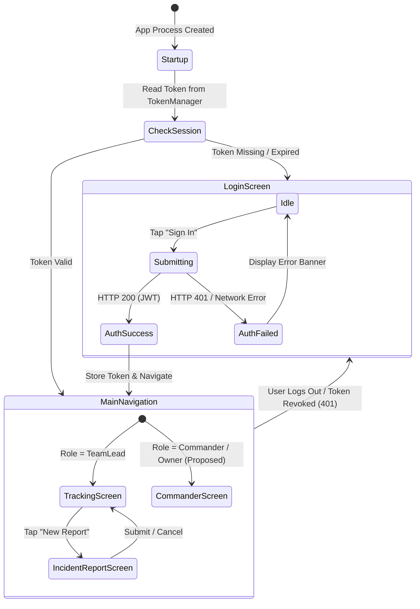
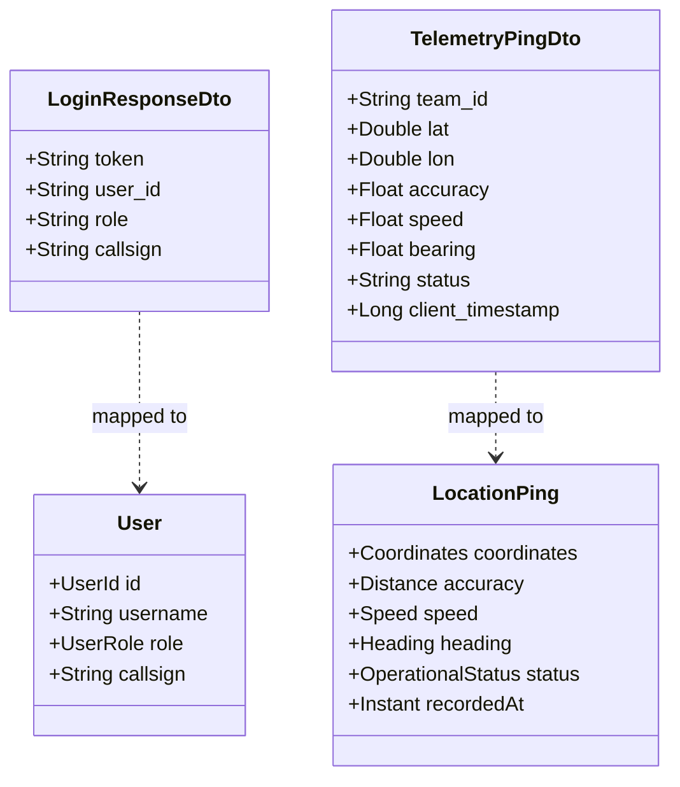

# WayMate — Android Architecture Specification

## 1. Document Status and Context

### 1.1 Status
- **Current Milestone**: Pre-Commit Checkpoint (Phases 0–14 + Phase 7.2 Complete).
- **Status**: **STABILIZED & VERIFIED**
- **Scope**: Defines the structural layers, package organization, data flow, navigation flow, networking boundaries, and testing strategy for the WayMate Android application (`ir.alifaniani.waymate`).
- **Primacy**: This document reflects the verified implementation as guided by [AGENTS.md](file:///E:/2.Things/Android-Projects/WayMate/AGENTS.md), [docs/requirements.md](file:///E:/2.Things/Android-Projects/WayMate/docs/requirements.md), and [docs/phase-7.2-operational-geolocation.md](file:///E:/2.Things/Android-Projects/WayMate/docs/phase-7.2-operational-geolocation.md).

---

## 2. Architectural Pattern and Design Principles

The WayMate Android application follows a **Pragmatic Clean Architecture** approach tailored for a small, incrementally developed Kotlin and Jetpack Compose codebase.

```mermaid
graph TD
    subgraph Presentation_Layer ["UI / Presentation Layer (Jetpack Compose)"]
        UI["Compose Screens & Components"]
        VM["Architecture Components ViewModel"]
        UIState["Immutable UiState"]
        UIEvent["User UiEvents"]
        UI -->|Dispatches Events| VM
        VM -->|Emits StateFlow| UIState
        UIState -->|Rendered by| UI
    end

    subgraph Domain_Layer ["Domain Layer (Pure Kotlin)"]
        UC["Use Cases / Interactors (Optional Orchestration)"]
        RepoInterface["Repository Interfaces (Contracts)"]
        DomainModel["Domain Models (Pure Data Classes)"]
        VM -->|Invokes| UC
        VM -->|Or direct call| RepoInterface
        UC -->|Calls| RepoInterface
        RepoInterface -.->|Returns| DomainModel
    end

    subgraph Data_Layer ["Data Layer (Repositories & Data Sources)"]
        RepoImpl["Repository Implementations"]
        RemoteSource["Remote Data Source (HTTP API Client)"]
        LocalSource["Local Data Source (Room Database / DataStore)"]
        DTO["Remote DTOs (Request / Response)"]
        Entity["Local Database Entities"]
        RepoInterface <|-- RepoImpl
        RepoImpl --> RemoteSource
        RepoImpl --> LocalSource
        RemoteSource --> DTO
        LocalSource --> Entity
    end

    subgraph Core_Layer ["Core Foundation"]
        Security["Token Storage & Keystore"]
        Network["Network Monitor & HTTP Config"]
        Common["Result<T>, AppDispatchers, Exceptions"]
    end

    Data_Layer -.->|Mappers: DTO/Entity -> DomainModel| Domain_Layer
    Data_Layer --> Core_Layer
    Presentation_Layer --> Core_Layer
```

### 2.1 Core Architectural Principles
1. **Unidirectional Data Flow (UDF)**:
   - State flows down from the `ViewModel` to the Compose UI via Kotlin `StateFlow<UiState>`.
   - Events (user actions, lifecycle triggers) flow up from the Compose UI to the `ViewModel` via explicit `UiEvent` sealed interfaces.
2. **Separation of Concerns**:
   - The UI layer knows *how to display* information; it never executes business rules, performs calculations, or directly triggers network/database calls.
   - The Domain layer encapsulates *what the business does*; it is pure Kotlin with zero dependencies on the Android framework or UI toolkits.
   - The Data layer handles *where data comes from*; it abstracts network endpoints, local caching, and serialization from the rest of the application.
3. **Single Source of Truth (SSOT)**:
   - Repositories act as the single source of truth for each operational domain. The UI does not distinguish whether data originates from local cache or remote API.
4. **Single-Module First**:
   - The application starts as a clean single `:app` module with strict package boundaries. Premature modularization (e.g. multi-module Gradle setups) is avoided until the feature set justifies the build-graph overhead.
5. **Simplicity Over Indirection**:
   - Direct ViewModel-to-Repository calls are permitted for straightforward CRUD operations. Dedicated Use Cases (`usecase/`) are introduced only when business logic requires multi-repository orchestration or non-trivial domain rules (e.g., location telemetry dispatching, store-and-forward queue draining).

---

## 3. Layer Descriptions and Responsibilities

| Layer | Primary Responsibilities | Permitted Dependencies | Prohibited Dependencies |
| :--- | :--- | :--- | :--- |
| **Presentation (UI)** | - Renders UI using declarative Jetpack Compose.<br>- Manages screen-level UI state in `ViewModel`.<br>- Observes lifecycle and handles configuration changes.<br>- Dispatches tactical haptics, alerts, and navigation routes. | - `domain` (models, repository interfaces, use cases)<br>- `core` (Result, Dispatchers, utilities)<br>- Jetpack Compose & Android lifecycle libraries | - `data` (no direct access to DTOs, DAOs, or network clients)<br>- Retrofit / Ktor / Room directly |
| **Domain** | - Defines pure business models (`domain/model`).<br>- Defines abstract repository contracts (`domain/repository`).<br>- Implements reusable domain logic (`domain/usecase`). | - `core` (primitives, custom exceptions, Dispatcher interfaces)<br>- Pure Kotlin standard library | - **Android framework (`android.*`)**<br>- **Jetpack Compose (`androidx.compose.*`)**<br>- **Any database or networking library** |
| **Data** | - Implements repository interfaces defined in `domain`.<br>- Fetches data from remote HTTP endpoints via API client.<br>- Persists and buffers data in local SQLite database.<br>- Maps between Transport DTOs, Database Entities, and Domain Models. | - `domain` (implements contracts, returns domain models)<br>- `core` (network monitor, token manager, dispatchers)<br>- Network client (Retrofit/Ktor), Room database | - `ui` (must never import Compose, ViewModels, or UI components) |
| **Core** | - Cross-cutting utilities, Dispatcher provider, base `Result<T>`.<br>- Token storage abstraction and Android Keystore wrapper.<br>- Network connectivity observer. | - Android platform primitives where strictly needed (Context for Keystore, ConnectivityManager). | - `ui`, `domain`, or `data` features (no circular dependencies). |

---

## 4. Proposed Package Structure

The package tree is rooted at the project's established package identifier: `ir.alifaniani.waymate`.

```text
ir.alifaniani.waymate/
├── WayMateApp.kt                       // Application class, initializes DI container & logging
├── MainActivity.kt                     // Single Activity entrypoint hosting Compose navigation
│
├── core/                               // Cross-cutting foundation components
│   ├── common/                         // Result wrapper, dispatchers, extension functions
│   │   ├── Result.kt                   // Sealed class Result<out T> (Success, Error, Loading)
│   │   ├── DispatcherProvider.kt       // Coroutine dispatcher abstraction for testability
│   │   └── AppExceptions.kt            // Domain-level exception definitions
│   ├── network/                        // Network utilities and configuration
│   │   ├── NetworkMonitor.kt           // Interface and Android ConnectivityManager observer
│   │   ├── AuthInterceptor.kt          // Injects Authorization: Bearer <token>
│   │   └── ApiConstants.kt             // Endpoint paths and network timeout defaults
│   ├── database/                       // Local database infrastructure
│   │   └── AppDatabase.kt              // RoomDatabase definition and migration hooks
│   └── security/                       // Secure credential storage
│       └── TokenManager.kt             // Interface & implementation using EncryptedSharedPreferences
│
├── data/                               // Data layer implementations
│   ├── repository/                     // Repository implementations
│   │   ├── AuthRepositoryImpl.kt       // Authentication & session repository
│   │   ├── TelemetryRepositoryImpl.kt  // GPS telemetry & buffer repository
│   │   └── IncidentRepositoryImpl.kt   // Incident reporting repository
│   ├── remote/                         // Remote HTTP networking
│   │   ├── api/                        // Retrofit / Ktor API interface definitions
│   │   │   └── WayMateApiService.kt    // All REST endpoint declarations
│   │   ├── model/                      // Data Transfer Objects (DTOs)
│   │   │   ├── request/                // Request payloads (e.g., LoginRequestDto.kt)
│   │   │   └── response/               // Response payloads (e.g., LiveUnitDto.kt)
│   │   └── mapper/                     // DTO <-> Domain model transformation functions
│   │       ├── AuthMapper.kt
│   │       ├── TelemetryMapper.kt
│   │       └── IncidentMapper.kt
│   └── local/                          // Local persistence & offline buffering
│       ├── dao/                        // Room Data Access Objects
│       │   ├── TelemetryQueueDao.kt    // Offline telemetry buffer DAO
│       │   └── IncidentQueueDao.kt     // Offline incident buffer DAO
│       ├── entity/                     // Room SQLite database entities
│       │   ├── TelemetryQueueEntity.kt // Queued location ping entity
│       │   └── IncidentQueueEntity.kt  // Queued incident report entity
│       └── mapper/                     // Entity <-> Domain model transformation functions
│           └── LocalStorageMapper.kt
│
├── domain/                             // Pure Kotlin business rules & contracts (NO Android imports)
│   ├── model/                          // Business entities
│   │   ├── User.kt                     // User profile, identity, callsign
│   │   ├── UserRole.kt                 // Enum: Owner, Commander, TeamLead
│   │   ├── Team.kt                     // Team metadata, roster, vehicle specs
│   │   ├── LocationPing.kt             // Coordinates, accuracy, speed, timestamp
│   │   ├── OperationalStatus.kt        // Enum: Normal, Pursuing, Engaged
│   │   ├── LiveUnit.kt                 // Composite model for live situational map
│   │   ├── Incident.kt                 // Incident report model
│   │   └── LinkHealth.kt               // Communication status (Online, Stale, Offline)
│   ├── repository/                     // Abstract repository interfaces
│   │   ├── AuthRepository.kt           // Contract for login, logout, session query
│   │   ├── TelemetryRepository.kt      // Contract for location uplink & live feed
│   │   └── IncidentRepository.kt       // Contract for quick alerts & reports
│   └── usecase/                        // Orchestration use cases (introduced as needed)
│       ├── SubmitLocationPingUseCase.kt// Validates fix, sends online or queues offline
│       ├── DispatchQuickAlertUseCase.kt// High-priority emergency trigger
│       └── SyncOfflineQueueUseCase.kt  // Drains local SQLite buffer upon reconnect
│
└── ui/                                 // Presentation layer (Jetpack Compose & ViewModels)
    ├── navigation/                     // Screen routing and navigation graph
    │   ├── WayMateNavGraph.kt          // NavHost and composable route definitions
    │   └── Screen.kt                   // Sealed class defining type-safe route destinations
    ├── theme/                          // Design tokens & styling
    │   ├── Color.kt                    // Dark Tactical color tokens (OLED dark, status colors)
    │   ├── Theme.kt                    // WayMateTheme Composable definition
    │   └── Type.kt                     // Typography configuration with Persian font support
    ├── common/                         // Reusable tactical UI components
    │   ├── TacticalTopBar.kt           // Top app bar with connectivity indicator
    │   ├── StatusBadge.kt              // Green/Amber/Red tactical status chip
    │   ├── QuickActionButton.kt        // Floating Action Button for emergency alerts
    │   └── ErrorDialog.kt              // Standardized error alert modal
    ├── auth/                           // Authentication feature
    │   ├── LoginScreen.kt              // Compose login screen
    │   ├── LoginViewModel.kt           // Handles authentication business flow
    │   └── LoginUiState.kt             // Sealed class / data class for login state
    ├── tracking/                       // Field Tracking & Tactical Map feature
    │   ├── TrackingScreen.kt           // Tactical Map screen with Compose map view
    │   ├── TrackingViewModel.kt        // Manages location updates, status, and alerts
    │   ├── TrackingUiState.kt          // Current tracking state (Active, Paused, Offline)
    │   └── StatusSelectorSheet.kt      // Bottom sheet for 2-tap status change
    └── incidents/                      // Incident Reporting feature
        ├── IncidentReportScreen.kt     // Structured incident form
        ├── IncidentViewModel.kt        // Form validation and submission
        └── IncidentUiState.kt          // Form field states, validation errors, submit progress
```

---

## 5. Initial Application and Navigation Flow

### 5.1 Application Startup and Authentication Gate



### 5.2 Initial Navigation Destinations
1. **`Screen.Login`**:
   - Starting point for unauthenticated users.
   - Collects credentials, shows loading spinner during auth, presents localized error messages.
2. **`Screen.Tracking`** (Main Destination for Field Team Leads):
   - Tactical map canvas with current location reticle.
   - Quick Action floating emergency button.
   - Tactical status selector chip (`Normal`, `Pursuing`, `Engaged`).
   - Connectivity health indicator banner (`Online`, `Offline — X items queued`).
3. **`Screen.IncidentReport`**:
   - Accessible from Tracking screen via menu or button.
   - Allows detailed incident submission (type, notes, coordinates).
4. **`Screen.Commander`** (Proposed for Phase 2B / Milestone 3):
   - Multi-unit tactical map overview displaying all deployed teams.

---

## 6. Data and Network Boundaries

### 6.1 Transport DTOs vs. Domain Models
To maintain strict separation between the Cloudflare Workers API contract and the internal Android logic, network serialization models must never escape the `data` layer.



### 6.2 Repository Contracts (Domain Layer)
Repository interfaces reside in `domain/repository` and use Kotlin Coroutines (`suspend`) and `Flow`:

```kotlin
// domain/repository/AuthRepository.kt
interface AuthRepository {
    suspend fun login(username: String, password: String): Result<User>
    suspend fun getActiveUser(): User?
    suspend fun logout(): Result<Unit>
    fun isSessionActive(): Flow<Boolean>
}

// domain/repository/TelemetryRepository.kt
interface TelemetryRepository {
    suspend fun sendLocationPing(ping: LocationPing): Result<Unit>
    suspend fun queueOfflinePing(ping: LocationPing): Result<Unit>
    fun getQueuedPingCount(): Flow<Int>
    suspend fun flushOfflineQueue(): Result<Int>
    fun observeLiveUnits(): Flow<List<LiveUnit>>
}
```

### 6.3 Network Error Handling & Retry Policy
- **Network Failures**: Catch `IOException` (connection loss, DNS failure, timeout) and map them to domain `AppException.NetworkException`.
- **HTTP Errors**:
  - `401 Unauthorized`: Trigger automatic session clearing via `TokenManager` and emit `SessionExpired` navigation event.
  - `403 Forbidden`: Map to `AppException.AuthorizationException` (action not permitted for user's role).
  - `422 Unprocessable Entity`: Map to `AppException.ValidationException` with field error list.
  - `5xx Server Error`: Log error safely (excluding credentials) and queue operation if offline-bufferable.
- **Offline Buffering Policy**: Non-idempotent operations or telemetry streams (`sendLocationPing`, `submitIncident`) automatically fail-over to the local SQLite queue (`offline_queue` table) upon network exceptions.

---

## 7. Dependency Injection Strategy

### 7.1 Decision Summary (Detailed in Decision Log `AD-008`)
- **PROPOSED RECOMMENDATION**: **Manual Constructor Injection with an Application-Level Container (`AppContainer`)**.
- **Rationale**:
  - WayMate is an educational, incrementally built application.
  - Dagger Hilt introduces heavy annotation processing (KSP/kapt), significant build-time overhead, complex generated code, and steep debugging hurdles.
  - A clean `AppContainer` pattern provides 100% compile-time safety, zero reflection, zero code generation, near-instant build times, and straightforward testing with fakes.
  - If the dependency graph becomes complex in Phase 10+, migrating from a clean manual container to Koin or Hilt is straightforward.

### 7.2 Container Implementation Outline (Proposed for Phase 2B)
```kotlin
// core/di/AppContainer.kt
interface AppContainer {
    val authRepository: AuthRepository
    val telemetryRepository: TelemetryRepository
    val incidentRepository: IncidentRepository
    val networkMonitor: NetworkMonitor
}

class DefaultAppContainer(private val context: Context) : AppContainer {
    private val tokenManager: TokenManager by lazy {
        EncryptedTokenManager(context)
    }
    private val apiService: WayMateApiService by lazy {
        RetrofitClient.create(tokenManager)
    }
    private val database: AppDatabase by lazy {
        AppDatabase.getInstance(context)
    }
    override val authRepository: AuthRepository by lazy {
        AuthRepositoryImpl(apiService, tokenManager)
    }
    override val telemetryRepository: TelemetryRepository by lazy {
        TelemetryRepositoryImpl(apiService, database.telemetryQueueDao())
    }
    override val incidentRepository: IncidentRepository by lazy {
        IncidentRepositoryImpl(apiService, database.incidentQueueDao())
    }
    override val networkMonitor: NetworkMonitor by lazy {
        LiveNetworkMonitor(context)
    }
}
```

---

## 8. Quality, Testing, and Educational Verification Strategy

To adhere to the project goal of a stable, testable educational application:

### 8.1 Testing Pyramid
1. **Unit Tests (Local JVM — Fast & Deterministic)**:
   - Target: `domain/usecase`, `ui/*ViewModel`, `data/mapper`.
   - Tooling: JUnit 4, Kotlin Coroutines Test (`StandardTestDispatcher`, `runTest`), Truth / AssertJ.
   - Strategy: **Fake Repositories** implemented in test source sets (`FakeAuthRepository`, `FakeTelemetryRepository`). Avoid brittle, over-specified mock frameworks (MockK/Mockito) where simple in-memory fakes provide clearer, more maintainable tests.
2. **Repository & Integration Tests**:
   - Target: `data/repository/*Impl`, Room DAOs.
   - Tooling: In-memory Room database (`Room.inMemoryDatabaseBuilder`), MockWebServer for simulating Cloudflare Worker HTTP responses and failure conditions.
3. **UI / Compose Tests (Instrumented / Robolectric)**:
   - Target: Compose screens, theme verification, RTL layout validation.
   - Tooling: `createComposeRule()`.

### 8.2 Synthetic Test Data Policy
In accordance with *AGENTS.md* security rules:
- All tests, demonstrations, and initial development must utilize **strictly synthetic test accounts** (e.g. `test_commander`, `patrol_alpha_lead`) and simulated coordinates (e.g., public landmarks or fictional grid offsets).
- Never use real personal credentials, phone numbers, or operational coordinates in test fixtures.

---

## 9. Security, Privacy, and Educational Scope Boundaries

### 9.1 Location Sharing Transparency
- When location tracking is introduced in subsequent phases:
  1. The app must never acquire or transmit location silently.
  2. A persistent visual indicator (e.g. green pulsating status chip) must be visible on every active screen.
  3. An Android Foreground Service notification must remain visible in the system shade with a clear "Stop Patrol" action.
  4. Location sharing must be initiated exclusively by an explicit user tap ("Start Patrol").

### 9.2 Safe Logging & Data Minimization
- **Strict Logging Hygiene**:
  - Bearer tokens, passwords, and private session cookies must **never** be output to Android Logcat or error logs.
  - Latitude and longitude coordinates must not be logged in plaintext debug logs in production builds.
- **Zero Client Trust**:
  - The Android app must assume the server will reject unauthorized requests. Client-side role checks are strictly for UI optimization (e.g. hiding commander controls from a field operator), while authorization is authoritatively enforced by Cloudflare Workers.

---

## 10. Resolved Architectural Decisions

The architectural selections originally evaluated in Phase 2A have been resolved and implemented as follows:

1. **Map Rendering Engine**:
   - **Implemented:** Custom **Jetpack Compose Canvas 2D Engine** (`TacticalMapCanvas`).
   - **Rationale:** Avoids heavyweight closed/native map SDK dependencies; enables lightweight offline rendering of Jahrom vector thoroughfares, waterways, hiking simulation, and live comrade marker HUDs.
2. **Real-Time Transport**:
   - **Implemented:** **WebSocket over Cloudflare Durable Objects** (`LocationSessionDO`).
   - **Rationale:** Minimizes latency for live location streaming; utilizes in-memory edge fan-out without database write overhead; authenticated via `Authorization: Bearer <token>` handshake header.
3. **Dependency Injection**:
   - **Implemented:** **Manual `AppContainer` Injection**.
   - **Rationale:** Clear compile-time dependency wiring without code generation overhead (Dagger/Hilt) or reflection, well-suited for a clean educational architecture.
4. **Networking Engine**:
   - **Implemented:** **OkHttp + Kotlinx Serialization**.
   - **Rationale:** Lightweight, type-safe JSON serialization and bidirectional WebSocket support.
5. **Local Storage**:
   - **Implemented:** **Native Android SQLite** (`WayMateDatabaseHelper`, `SqliteOfflineStorage`).
   - **Rationale:** Reliable, zero-dependency offline persistence with transactional store-and-forward queue (`offline_queue`).
