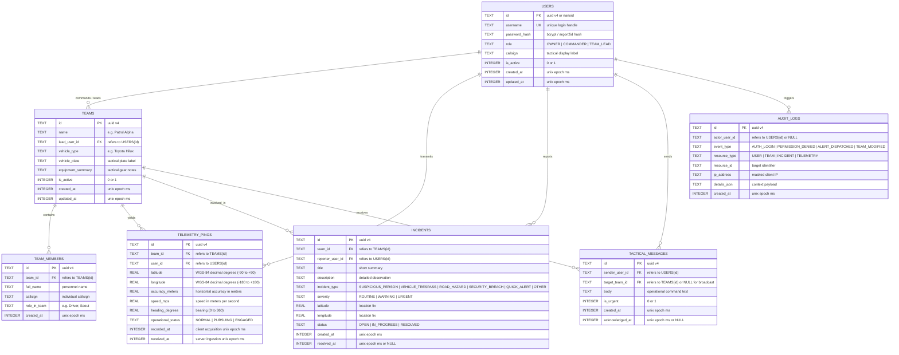

# WayMate — Cloudflare D1 Database Schema & Data Models Specification

## 1. Executive Summary & Design Principles

This document defines the structured persistent data schema for WayMate's serverless backend on **Cloudflare D1** (SQLite-compatible) in alignment with [AGENTS.md](file:///E:/2.Things/Android-Projects/WayMate/AGENTS.md), [docs/architecture.md](file:///E:/2.Things/Android-Projects/WayMate/docs/architecture.md), and [docs/mvp-plan.md](file:///E:/2.Things/Android-Projects/WayMate/docs/mvp-plan.md).

### 1.1 Design Principles
1. **Zero-Budget & Free-Tier Optimization**: Schema and queries are optimized to stay strictly within Cloudflare D1 free-tier allowances (5 million row reads/day, 100,000 row writes/day, 10 GB total storage).
2. **Relational Integrity with Cascading Protection**: Uses foreign keys with explicit `ON DELETE CASCADE` or `RESTRICT` rules to avoid orphaned telemetry or operational records.
3. **High-Performance Spatial/Temporal Indexing**: Compound B-tree indices on `(team_id, recorded_at DESC)` ensure latest live unit position queries complete with sub-millisecond execution times.
4. **Data Retention & Pruning Strategy**: Clear policies define lifespan for transient telemetry versus permanent operational incident reports.
5. **No Binary Blobs**: In accordance with the strict exclusion of Cloudflare R2, image/binary attachments are not stored in D1.

---

## 2. Entity Relationship Diagram (ERD)



---

## 3. DDL Schema Definition (SQLite / Cloudflare D1)

```sql
-- Migration: 0001_initial_schema.sql
-- Cloudflare D1 SQLite Compatible Schema

PRAGMA foreign_keys = ON;

-- 1. Users Table
CREATE TABLE IF NOT EXISTS users (
    id TEXT PRIMARY KEY,
    username TEXT NOT NULL COLLATE NOCASE,
    password_hash TEXT NOT NULL,
    role TEXT NOT NULL CHECK (role IN ('OWNER', 'COMMANDER', 'TEAM_LEAD')),
    callsign TEXT NOT NULL,
    is_active INTEGER NOT NULL DEFAULT 1 CHECK (is_active IN (0, 1)),
    created_at INTEGER NOT NULL,
    updated_at INTEGER NOT NULL
);

CREATE UNIQUE INDEX IF NOT EXISTS idx_users_username ON users (username);
CREATE INDEX IF NOT EXISTS idx_users_role ON users (role);

-- 2. Teams Table
CREATE TABLE IF NOT EXISTS teams (
    id TEXT PRIMARY KEY,
    name TEXT NOT NULL,
    lead_user_id TEXT NOT NULL,
    vehicle_type TEXT NOT NULL,
    vehicle_plate TEXT NOT NULL,
    equipment_summary TEXT NOT NULL DEFAULT '',
    is_active INTEGER NOT NULL DEFAULT 1 CHECK (is_active IN (0, 1)),
    created_at INTEGER NOT NULL,
    updated_at INTEGER NOT NULL,
    FOREIGN KEY (lead_user_id) REFERENCES users (id) ON DELETE RESTRICT
);

CREATE INDEX IF NOT EXISTS idx_teams_lead_user_id ON teams (lead_user_id);
CREATE INDEX IF NOT EXISTS idx_teams_is_active ON teams (is_active);

-- 3. Team Members Table (Personnel without client apps)
CREATE TABLE IF NOT EXISTS team_members (
    id TEXT PRIMARY KEY,
    team_id TEXT NOT NULL,
    full_name TEXT NOT NULL,
    callsign TEXT NOT NULL,
    role_in_team TEXT NOT NULL,
    created_at INTEGER NOT NULL,
    FOREIGN KEY (team_id) REFERENCES teams (id) ON DELETE CASCADE
);

CREATE INDEX IF NOT EXISTS idx_team_members_team_id ON team_members (team_id);

-- 4. Telemetry Pings Table (High-volume Blue Force Tracking stream)
CREATE TABLE IF NOT EXISTS telemetry_pings (
    id TEXT PRIMARY KEY,
    team_id TEXT NOT NULL,
    user_id TEXT NOT NULL,
    latitude REAL NOT NULL CHECK (latitude BETWEEN -90.0 AND 90.0),
    longitude REAL NOT NULL CHECK (longitude BETWEEN -180.0 AND 180.0),
    accuracy_meters REAL NOT NULL CHECK (accuracy_meters >= 0.0),
    speed_mps REAL NOT NULL DEFAULT 0.0 CHECK (speed_mps >= 0.0),
    heading_degrees REAL NOT NULL DEFAULT 0.0 CHECK (heading_degrees BETWEEN 0.0 AND 360.0),
    operational_status TEXT NOT NULL DEFAULT 'NORMAL' CHECK (operational_status IN ('NORMAL', 'PURSUING', 'ENGAGED')),
    recorded_at INTEGER NOT NULL,
    received_at INTEGER NOT NULL,
    FOREIGN KEY (team_id) REFERENCES teams (id) ON DELETE CASCADE,
    FOREIGN KEY (user_id) REFERENCES users (id) ON DELETE CASCADE
);

-- Compound index for rapid latest unit position lookups
CREATE INDEX IF NOT EXISTS idx_telemetry_team_recorded ON telemetry_pings (team_id, recorded_at DESC);
CREATE INDEX IF NOT EXISTS idx_telemetry_received_at ON telemetry_pings (received_at DESC);

-- 5. Incidents Table
CREATE TABLE IF NOT EXISTS incidents (
    id TEXT PRIMARY KEY,
    team_id TEXT NOT NULL,
    reporter_user_id TEXT NOT NULL,
    title TEXT NOT NULL,
    description TEXT NOT NULL,
    incident_type TEXT NOT NULL CHECK (incident_type IN (
        'SUSPICIOUS_PERSON', 'VEHICLE_TRESPASS', 'ROAD_HAZARD', 'SECURITY_BREACH', 'QUICK_ALERT', 'OTHER'
    )),
    severity TEXT NOT NULL CHECK (severity IN ('ROUTINE', 'WARNING', 'URGENT')),
    latitude REAL NOT NULL CHECK (latitude BETWEEN -90.0 AND 90.0),
    longitude REAL NOT NULL CHECK (longitude BETWEEN -180.0 AND 180.0),
    status TEXT NOT NULL DEFAULT 'OPEN' CHECK (status IN ('OPEN', 'IN_PROGRESS', 'RESOLVED')),
    created_at INTEGER NOT NULL,
    resolved_at INTEGER,
    FOREIGN KEY (team_id) REFERENCES teams (id) ON DELETE RESTRICT,
    FOREIGN KEY (reporter_user_id) REFERENCES users (id) ON DELETE RESTRICT
);

CREATE INDEX IF NOT EXISTS idx_incidents_status_created ON incidents (status, created_at DESC);
CREATE INDEX IF NOT EXISTS idx_incidents_team ON incidents (team_id);

-- 6. Tactical Messages Table
CREATE TABLE IF NOT EXISTS tactical_messages (
    id TEXT PRIMARY KEY,
    sender_user_id TEXT NOT NULL,
    target_team_id TEXT, -- NULL denotes broadcast to all teams
    body TEXT NOT NULL,
    is_urgent INTEGER NOT NULL DEFAULT 0 CHECK (is_urgent IN (0, 1)),
    created_at INTEGER NOT NULL,
    acknowledged_at INTEGER,
    FOREIGN KEY (sender_user_id) REFERENCES users (id) ON DELETE RESTRICT,
    FOREIGN KEY (target_team_id) REFERENCES teams (id) ON DELETE CASCADE
);

CREATE INDEX IF NOT EXISTS idx_messages_target_created ON tactical_messages (target_team_id, created_at DESC);

-- 7. Audit Event Logs Table
CREATE TABLE IF NOT EXISTS audit_logs (
    id TEXT PRIMARY KEY,
    actor_user_id TEXT,
    event_type TEXT NOT NULL CHECK (event_type IN (
        'AUTH_LOGIN_SUCCESS', 'AUTH_LOGIN_FAILED', 'PERMISSION_DENIED',
        'EMERGENCY_ALERT_DISPATCHED', 'TEAM_CREATED', 'TEAM_UPDATED', 'INCIDENT_RESOLVED'
    )),
    resource_type TEXT NOT NULL,
    resource_id TEXT NOT NULL,
    ip_address TEXT NOT NULL,
    details_json TEXT NOT NULL DEFAULT '{}',
    created_at INTEGER NOT NULL
);

CREATE INDEX IF NOT EXISTS idx_audit_logs_event_created ON audit_logs (event_type, created_at DESC);
CREATE INDEX IF NOT EXISTS idx_audit_logs_created_at ON audit_logs (created_at DESC);
```

---

## 4. Data Retention, Archival & Pruning Policy

| Entity | Retention Duration | Pruning Mechanism | Justification |
| :--- | :--- | :--- | :--- |
| **Telemetry Pings (Raw)** | **7 Days** | Daily cron Worker deletes records where `received_at < (now - 7 days)` | High frequency (15–30s per unit) would exceed free tier limits if held indefinitely. 7 days preserves tactical mission history. |
| **Telemetry Breadcrumbs (Hourly Aggregates)** | **30 Days** | Subsampled track points (1 point per 5 minutes) retained for mission playback review. | Low storage impact while allowing mission track debriefing. |
| **Incidents & Emergency Alerts** | **1 Year (or Indefinite)** | Never pruned automatically. Manual archival by System Owner. | Mission-critical records and security incident logs must remain intact for after-action review. |
| **Audit Logs** | **90 Days** | Automatic batch purge of logs older than 90 days. | Balances security audit trail compliance with D1 storage constraints. |
| **Store-and-Forward Client Queue** | **Max 1,000 pings on device** | FIFO drop of oldest `NORMAL` pings when buffer exceeds 1,000. `URGENT` / incident alerts are never dropped. | Prevents Android SQLite database from unbounded disk growth during prolonged offline expeditions. |

---

## 5. Synthetic Development Seed Data

For initial local development and integration tests, synthetic data uses strictly fictional operational identifiers:

```sql
-- Synthetic Seed Data for Development and Testing
INSERT OR IGNORE INTO users (id, username, password_hash, role, callsign, is_active, created_at, updated_at) VALUES
('usr_owner_001', 'owner_demo', '$2a$12$e80b...synthetic_hash...', 'OWNER', 'Alpha-Base (متولی اصلی)', 1, 1729000000000, 1729000000000),
('usr_cmd_001', 'commander_demo', '$2a$12$e80b...synthetic_hash...', 'COMMANDER', 'Eagle-1 (فرمانده)', 1, 1729000000000, 1729000000000),
('usr_lead_001', 'patrol_lead_demo', '$2a$12$e80b...synthetic_hash...', 'TEAM_LEAD', 'Falcon-Lead (سرتیم آلفا)', 1, 1729000000000, 1729000000000);

INSERT OR IGNORE INTO teams (id, name, lead_user_id, vehicle_type, vehicle_plate, equipment_summary, is_active, created_at, updated_at) VALUES
('team_alpha_001', 'گشت آلفا (واکنش سریع)', 'usr_lead_001', 'تویوتا هایلوکس', '۴۴-ب-۱۲', 'بی‌سیم فرکانس اختصاصی، جعبه امداد تاکتیکی', 1, 1729000000000, 1729000000000);

INSERT OR IGNORE INTO team_members (id, team_id, full_name, callsign, role_in_team, created_at) VALUES
('mem_001', 'team_alpha_001', 'رضا کریمی', 'البرز ۱', 'راننده و اپراتور فنی', 1729000000000),
('mem_002', 'team_alpha_001', 'محمد حسینی', 'سهند ۲', 'دیده‌بان و سرتیم', 1729000000000);
```
