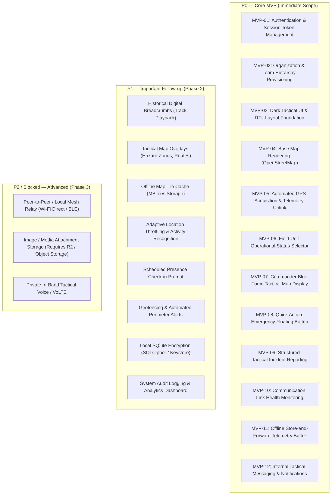
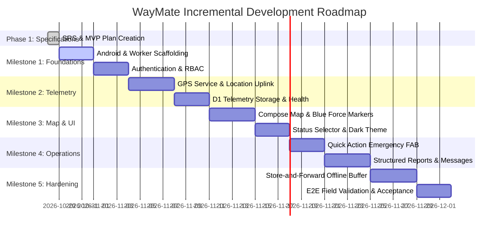

# WayMate — MVP Specification and Execution Plan

## 1. Executive Summary and MVP Philosophy

The goal of the WayMate Minimum Viable Product (MVP) is to establish a rock-solid, secure, end-to-end tactical field baseline consisting of:
1. An **Android native application** (Kotlin, Jetpack Compose) running on field operators' smartphones.
2. A **serverless backend API** (Cloudflare Workers) and structured persistent storage (Cloudflare D1).
3. A core operational loop: **Authentication -> Live GPS Location Acquisition -> Telemetry Transmission -> Situational Map Display -> Emergency Quick Alert -> Store-and-Forward Offline Resilience**.

### Guiding Principles
- **Small & Incremental**: Build the absolute minimum necessary to conduct a live two-party field test (Commander watching a Patrol Lead on a live tactical map).
- **Zero-Budget & Sovereign**: Rely entirely on national/intranet networking and free-tier infrastructure.
- **Fail-Safe & Offline-Aware**: Telemetry and alerts must never be silently discarded when the connection drops.
- **No Scope Bloat**: Complex features (mesh relay, geofencing, custom vector tile compilation) are strictly deferred to Phase 2 and beyond.

---

## 2. Feature Prioritization Inventory

---

## 3. P0 — Detailed MVP Feature Specifications

### `MVP-01`: Authentication & Session Token Management
1. **User Problem**: Field devices and command interfaces must securely authenticate against the backend so unauthorized actors cannot spoof locations or inspect tactical operations.
2. **User Roles**: System Owner, Commander, Patrol Team Lead.
3. **Preconditions**: User accounts provisioned in database with bcrypt-hashed credentials.
4. **Main User Flow**:
   1. User launches the WayMate Android app.
   2. App displays login screen in Dark Tactical theme.
   3. User enters username and password and taps "Sign In" (*ورود*).
   4. App sends `POST /api/v1/auth/login`.
   5. Server validates password hash and issues a signed JWT containing user ID, username, and role.
   6. App saves JWT in secure storage and navigates to the main operational screen.
5. **Expected Result**: User authenticated, role verified, token automatically attached to subsequent API requests.
6. **Error and Edge Cases**:
   - Invalid password -> HTTP 401 with generic error "Invalid credentials".
   - Network failure -> User notified "Unable to reach server. Check network connection".
   - Expired token -> Client automatically redirects to login screen.
7. **Authorization & Privacy**: Passwords hashed with high-cost salt. Server rejects expired/tampered tokens.
8. **Acceptance Criteria**:
   - GIVEN valid credentials, WHEN submitting login form, THEN user receives JWT and arrives at main map screen within 2 seconds.
   - GIVEN invalid credentials, WHEN submitting login form, THEN error is shown and no access is granted.
9. **Dependencies**: Cloudflare Workers API, D1 `users` table.
10. **Source Reference**: *سند پروژه.md (3.ب)*, *docs/architecture.md (Section 5)*.
11. **Classification**: Explicit Source Requirement.

---

### `MVP-02`: Organization & Team Hierarchy Provisioning
1. **User Problem**: Commanders need to assign callsigns, team members, vehicle details, and tactical gear to patrol units so they know who is deployed where.
2. **User Roles**: Commander, System Owner.
3. **Preconditions**: Commander authenticated.
4. **Main User Flow**:
   1. Commander accesses team management view.
   2. Commander creates team (e.g., "Patrol Alpha - گشت آلفا"), designates Team Lead account, enters vehicle model/plate, assigned equipment, and roster names.
   3. Backend records team and associates Team Lead user ID with team ID.
5. **Expected Result**: Team profile created; Team Lead can log in and immediately operate under this tactical identity.
6. **Error and Edge Cases**:
   - Designating a non-existent or duplicate user ID -> Form validation error.
7. **Authorization & Privacy**: Only users with role `Commander` or `Owner` can create/edit teams.
8. **Acceptance Criteria**:
   - GIVEN Commander credentials, WHEN creating a team with roster and vehicle specs, THEN team record is stored in D1 and visible in Commander's team list.
9. **Dependencies**: `MVP-01` Authentication, D1 `teams` & `team_members` tables.
10. **Source Reference**: *سند پروژه.md (3.ب)*.
11. **Classification**: Explicit Source Requirement.

---

### `MVP-03`: Dark Tactical UI & RTL Layout Foundation
1. **User Problem**: Nighttime tactical operations require zero bright screen glare to protect field operators' facial concealment, and Persian operators require natural Right-to-Left (RTL) typography.
2. **User Roles**: Patrol Team Lead, Commander.
3. **Preconditions**: App launched.
4. **Main User Flow**:
   1. App renders entire interface using a dedicated Dark Tactical design token palette (background `#0B0F14`, surface `#151B22`, tactical red alert `#D32F2F`, status green `#2E7D32`, status amber `#F57C00`).
   2. Layout directions, padding, and text alignments strictly adhere to Persian RTL conventions.
5. **Expected Result**: Professional, glare-free, ergonomically clean interface in Persian.
6. **Error and Edge Cases**: System dark/light theme change must not override app's tactical dark mode.
7. **Authorization & Privacy**: N/A (UI layer).
8. **Acceptance Criteria**:
   - Ambient light emitted by device is minimized.
   - RTL text alignment and Persian typography render with correct glyph shaping.
9. **Dependencies**: Jetpack Compose Material 3 Theme.
10. **Source Reference**: *سند پروژه.md (4.الف)*, *todo.md (مرحله ۳)*.
11. **Classification**: Explicit Source Requirement.

---

### `MVP-04`: Base Map Rendering (OpenStreetMap)
1. **User Problem**: Field units and commanders must have spatial awareness of roads, intersections, buildings, and terrain.
2. **User Roles**: Patrol Team Lead, Commander.
3. **Preconditions**: Network connection available to fetch OSM map tiles.
4. **Main User Flow**:
   1. User views main screen.
   2. Compose map container loads vector/raster tiles from designated OSM tile server.
   3. User can pan, pinch-zoom, and center on current GPS location.
5. **Expected Result**: Fluid 60fps map rendering with crisp labels and intuitive navigation.
6. **Error and Edge Cases**:
   - Tile load failure -> Display neutral grid placeholder without app crashing.
7. **Authorization & Privacy**: OpenStreetMap tile usage complies with license and user-agent policy.
8. **Acceptance Criteria**:
   - Map displays smoothly at standard zoom levels (12–18).
   - "Center on Me" button pans camera to current GPS fix.
9. **Dependencies**: Map SDK (MapLibre / osmdroid Compose integration).
10. **Source Reference**: *سند پروژه.md (3.الف)*.
11. **Classification**: Explicit Source Requirement.

---

### `MVP-05`: Automated GPS Acquisition & Telemetry Uplink
1. **User Problem**: Commander must continuously know where units are in the field without requiring units to make radio voice calls.
2. **User Roles**: Patrol Team Lead.
3. **Preconditions**: Team Lead authenticated; Location permission (`ACCESS_FINE_LOCATION`) granted.
4. **Main User Flow**:
   1. User taps "Start Patrol" (*شروع گشت*).
   2. App starts an Android Foreground Service displaying a persistent notification: *"WayMate: Tactical location sharing active"*.
   3. Service samples GPS coordinates every 15–30 seconds.
   4. App constructs telemetry packet: `{ teamId, lat, lon, accuracy, speed, heading, status, timestamp }`.
   5. App posts packet to `POST /api/v1/telemetry/location`.
5. **Expected Result**: Backend persists location ping in D1; Commander's map reflects unit position.
6. **Error and Edge Cases**:
   - GPS signal lost -> Packet transmission paused; notification indicates "Searching for GPS".
   - Network down -> Packet diverted to local Store-and-Forward buffer (`MVP-11`).
   - App placed in background -> Foreground Service continues uninterrupted location sampling.
7. **Authorization & Privacy**: Clear ongoing notification; Team Lead can stop patrol at any time.
8. **Acceptance Criteria**:
   - When active, coordinates are captured and received by server within 3 seconds of fix under normal network.
   - Backgrounding the app does not terminate location updates.
9. **Dependencies**: Android Foreground Service, LocationManager/FusedLocationProvider, Backend API.
10. **Source Reference**: *سند پروژه.md (3.ج)*, *Atak.txt (بند ۵)*, *AGENTS.md*.
11. **Classification**: Explicit Source Requirement.

---

### `MVP-06`: Field Unit Operational Status Selector
1. **User Problem**: The Commander must instantly know what situation the unit is dealing with (e.g. routine patrol vs pursuit vs armed confrontation).
2. **User Roles**: Patrol Team Lead.
3. **Preconditions**: Active patrol session.
4. **Main User Flow**:
   1. Team Lead taps the status chip on the map screen.
   2. A bottom sheet appears with options:
      - `Normal` (*عادی*) — Green
      - `Pursuing` (*در حال تعقیب*) — Amber
      - `Engaged / Confrontation` (*درگیر با مورد*) — Red
   3. User selects a state.
   4. Selection closes sheet, updates local UI, and sends immediate status update to server.
5. **Expected Result**: Commander's map marker for this team immediately switches color and icon to reflect the new state.
6. **Error and Edge Cases**:
   - Rapid status changes -> Backend debounces and records latest state accurately.
7. **Authorization & Privacy**: Field unit can only update their own team status.
8. **Acceptance Criteria**:
   - Selecting a new status immediately triggers an uplink and is reflected on Commander's console within 5 seconds.
9. **Dependencies**: `MVP-05` Telemetry, Backend API.
10. **Source Reference**: *سند پروژه.md (3.ج)*.
11. **Classification**: Explicit Source Requirement.

---

### `MVP-07`: Commander Blue Force Tactical Map Display
1. **User Problem**: The Commander needs a single-pane-of-glass map showing all deployed teams, their callsigns, current speeds, headings, and operational states.
2. **User Roles**: Commander, System Owner.
3. **Preconditions**: Commander authenticated; multiple field teams active.
4. **Main User Flow**:
   1. Commander opens the Situational Map.
   2. Client polls `GET /api/v1/telemetry/live` every 5–10 seconds.
   3. Map renders dynamic markers for all active units with callsign labels and heading arrows.
   4. Marker color corresponds to status: Green (Normal), Amber (Pursuing), Red (Engaged/Alert).
   5. Clicking a marker displays detail card: Team Lead name, vehicle, gear, last ping timestamp, GPS accuracy.
5. **Expected Result**: Accurate, low-latency tactical overview of all field assets.
6. **Error and Edge Cases**:
   - Unit stops sending pings -> Unit icon turns grey/stale after 3 minutes (`MVP-10`).
7. **Authorization & Privacy**: Commander only sees units in their assigned command perimeter.
8. **Acceptance Criteria**:
   - Multiple units render accurately at their coordinates.
   - Marker positions update seamlessly without map flickering.
9. **Dependencies**: `MVP-04` Map, `MVP-05` Telemetry, Backend API.
10. **Source Reference**: *سند پروژه.md (3.ج)*, *Atak.txt (بند ۵)*.
11. **Classification**: Explicit Source Requirement.

---

### `MVP-08`: Quick Action Emergency Floating Button
1. **User Problem**: Under sudden tactical threat or spotting a high-priority suspect, the operator has no time to type a report; they need a 1-tap/instant alert button.
2. **User Roles**: Patrol Team Lead.
3. **Preconditions**: App active.
4. **Main User Flow**:
   1. Field operator taps or holds the prominent Quick Action red floating button.
   2. App vibrates with haptic feedback to confirm trigger.
   3. App immediately captures current GPS fix.
   4. App dispatches `POST /api/v1/incidents/quick` with preset: *"Suspicious item/situation spotted"* (*مورد مشکوک رویت شد*).
   5. Server records incident with `severity: URGENT` and flags unit in emergency alert state.
5. **Expected Result**: Commander's screen sounds an audible alert, highlights unit marker with flashing red perimeter, and shows incident pin on map.
6. **Error and Edge Cases**:
   - Offline when triggered -> Buffered locally with highest priority tag; flushed the instant network is restored.
7. **Authorization & Privacy**: Quick alert action logged with exact user ID and timestamp.
8. **Acceptance Criteria**:
   - Activation takes ≤ 1 tap and completes transmission within 1.5s on stable network.
   - Immediate visual feedback on client confirming alert dispatch.
9. **Dependencies**: `MVP-05` Telemetry, `MVP-07` Commander Map.
10. **Source Reference**: *سند پروژه.md (4.ب)*, *Atak.txt (بند ۶)*.
11. **Classification**: Explicit Source Requirement.

---

### `MVP-09`: Structured Tactical Incident Reporting
1. **User Problem**: Operators need to report detailed observations (hazard type, suspect description, vehicle details) when time permits.
2. **User Roles**: Patrol Team Lead.
3. **Preconditions**: App active.
4. **Main User Flow**:
   1. User opens "New Report" (*گزارش رخداد*).
   2. User selects incident type from dropdown (Suspicious Person, Vehicle Trespassing, Road Hazard, Security Breach, Other).
   3. User enters text description.
   4. Coordinates auto-populate from current GPS (user can adjust pin on map if needed).
   5. User taps "Submit Report" (*ثبت گزارش*).
   6. Report is stored in D1 database and appears in Commander's incident roster and map.
5. **Expected Result**: Structured, timestamped, geo-tagged record for operational history.
6. **Error and Edge Cases**:
   - Empty description on non-preset type -> Form validation prompt.
   - Offline -> Queued in local store-and-forward buffer.
7. **Authorization & Privacy**: User can view their own submitted reports; Commander can view all team reports.
8. **Acceptance Criteria**:
   - Incident appears on Commander map as a tactical pin with popup details.
9. **Dependencies**: D1 `incidents` table, Compose form components.
10. **Source Reference**: *سند پروژه.md (4.ج)*.
11. **Classification**: Explicit Source Requirement.

---

### `MVP-10`: Communication Link Health Monitoring
1. **User Problem**: The Commander must immediately know if a team went silent or lost signal, indicating potential foul play, radio jamming, or equipment failure.
2. **User Roles**: Commander.
3. **Preconditions**: Teams active in field.
4. **Main User Flow**:
   1. Backend evaluates difference between `current_time` and `last_seen_timestamp` for each team.
   2. Teams are categorized:
      - `Online` (ping received < 60s ago): Bright green indicator.
      - `Stale / Warning` (ping received 60s–180s ago): Amber indicator.
      - `Offline / Disconnected` (no ping > 180s): Red/grey indicator with "Offline for X min" label.
   3. Commander roster displays connection health metrics at a glance.
5. **Expected Result**: Instant operational awareness of link integrity.
6. **Error and Edge Cases**:
   - Clock drift between device and server -> Server uses its own UTC time for `received_at` calculation.
7. **Authorization & Privacy**: Health status visible only to authorized command hierarchy.
8. **Acceptance Criteria**:
   - A team that disconnects its network transitions to "Offline" status on Commander screen after threshold expires.
9. **Dependencies**: `MVP-05` Telemetry, D1 database.
10. **Source Reference**: *سند پروژه.md (3.ج)*.
11. **Classification**: Explicit Source Requirement.

---

### `MVP-11`: Offline Store-and-Forward Telemetry Buffer
1. **User Problem**: Field teams frequently traverse basements, dead zones, or areas with intermittent national network coverage. Data must not be lost.
2. **User Roles**: Patrol Team Lead.
3. **Preconditions**: Network connection drops during active patrol.
4. **Main User Flow**:
   1. Network becomes unreachable.
   2. App detects network failure.
   3. Incoming GPS pings and incident reports are written directly to local SQLite buffer table `offline_queue`.
   4. A visual chip in the app indicates *"Offline — X items buffered"* (*آفلاین — ذخیره محلی*).
   5. Network connectivity is restored.
   6. Background sync worker automatically reads queued items in FIFO order, bundles them in a batch payload, and calls `POST /api/v1/telemetry/batch`.
   7. Backend inserts records with original capture timestamps.
   8. Local queue is cleared upon successful server acknowledgment.
5. **Expected Result**: 100% digital footprint preservation across network blackouts.
6. **Error and Edge Cases**:
   - Server returns 5xx error during batch upload -> Queue retained and retried with exponential backoff.
   - Device power reboot before upload -> SQLite storage persists queued items across restarts.
7. **Authorization & Privacy**: Replayed packets carry the user's valid session token.
8. **Acceptance Criteria**:
   - Disconnecting Wi-Fi/cellular, generating 10 pings, and reconnecting results in all 10 pings appearing in server D1 without timestamp distortion.
9. **Dependencies**: Local SQLite (Room), Android ConnectivityManager, Backend batch endpoint.
10. **Source Reference**: *سند پروژه.md (3.ج)*, *قابلیت اجرایی شدن پروژه.md (بخش ۲)*.
11. **Classification**: Explicit Source Requirement.

---

### `MVP-12`: Internal Tactical Messaging & Notifications
1. **User Problem**: Commander needs to broadcast operational orders (e.g. "Converge on intersection B", "Stand down") without relying on external commercial services like Google FCM.
2. **User Roles**: Commander, Patrol Team Lead.
3. **Preconditions**: Units online.
4. **Main User Flow**:
   1. Commander enters message in console, selects target (All Teams or specific Team), and submits.
   2. Message is stored in D1 `tactical_messages`.
   3. Field app receives message via periodic poll or active link.
   4. App displays high-contrast in-app banner and plays an alert sound.
   5. Operator taps "Acknowledge" (*مشاهده شد*), transmitting receipt stamp to server.
5. **Expected Result**: Rapid closed-loop tactical communication within sovereign network.
6. **Error and Edge Cases**:
   - Offline team -> Receives unread messages immediately upon next connection.
7. **Authorization & Privacy**: Field units cannot broadcast system-wide messages; only receive and reply to Commander.
8. **Acceptance Criteria**:
   - Broadcast message is delivered to active field app within 10 seconds under standard polling interval.
9. **Dependencies**: D1 `tactical_messages` table, Compose banner component.
10. **Source Reference**: *سند پروژه.md (4.د)*.
11. **Classification**: Explicit Source Requirement.

---

## 4. Deferred Scope (P1, P2, and Blocked)

| Feature | Deferred Tier | Technical Justification | Target Phase |
| :--- | :--- | :--- | :--- |
| **Historical Breadcrumbs (Track Playback)** | **P1** | Core MVP focuses on live situational awareness. Track reconstruction requires historical query pagination and timeline slider UI. | Phase 2 |
| **Tactical Map Layers (Hazards, Sensitive POIs)** | **P1** | Requires GeoJSON layer management and rendering engine customization. Base OSM map suffices for initial deployment. | Phase 2 |
| **Offline Map Tile Cache (MBTiles Storage)** | **P1** | Downloading and unpacking hundreds of megabytes of tile archives requires local file management and high storage logic. | Phase 2 |
| **Adaptive Location Frequency & Activity Detection** | **P1** | Requires integrating Google Activity Recognition or accelerometer algorithms. Fixed 15-30s intervals are adequate for initial field validation. | Phase 2 |
| **Geofencing & Automated Perimeter Alerts** | **P1** | Requires polygon ray-casting spatial algorithms on Cloudflare Workers or GIS extension. | Phase 2 |
| **Local SQLite Encryption (SQLCipher / AES-256)** | **P1** | Adds native binary dependencies (`sqlcipher-android`) and key lifecycle complexity. MVP validates functionality before hardening storage. | Phase 2 |
| **System Audit Logging & Analytics Dashboard** | **P1** | Secondary operational governance features not required for basic field tracking. | Phase 2 |
| **Peer-to-Peer / Local Mesh Relay** | **P2 / Blocked** | *قابلیت اجرایی شدن پروژه.md* designates P2P mesh relay as highest technical risk. Wi-Fi Direct and BLE mesh introduce severe battery drain and routing fragility. | Phase 3 |
| **Photo / File Attachments in Incident Reports** | **P2 / Blocked** | Cloudflare R2 is explicitly excluded by *AGENTS.md*. Storing raw images in Cloudflare D1 is an anti-pattern. Deferred until an object storage strategy is approved. | Phase 3 |

---

## 5. Incremental Implementation Milestones

### Milestone 1: Foundation, Authentication & Contracts
- **Deliverables**:
  - Cloudflare Worker skeleton with routing and JWT authentication middleware.
  - D1 database migrations for `users`, `teams`, `team_members`.
  - Android application theme (Dark Tactical), navigation scaffold, and login flow.
- **Definition of Done**:
  - Automated tests verify password hashing, token issue, and token validation.
  - Team Lead and Commander can authenticate from Android app.

### Milestone 2: Location Ingestion & Telemetry Pipeline
- **Deliverables**:
  - Android Foreground Service with FusedLocationProvider integration.
  - D1 `telemetry_pings` table schema and optimized spatial/timestamp indices.
  - `POST /api/v1/telemetry/location` and `GET /api/v1/telemetry/live` endpoints.
- **Definition of Done**:
  - Mobile device transmits coordinates continuously for 30 minutes in background.
  - Database stores coordinates with sub-second ingestion latency.

### Milestone 3: Tactical Map Display & Status Management
- **Deliverables**:
  - MapLibre / osmdroid integration in Jetpack Compose.
  - Live unit markers rendered with status color coding (Normal, Pursuing, Engaged).
  - Status bottom-sheet selector on Android client.
- **Definition of Done**:
  - Changing status on phone A immediately updates marker representation on Commander screen B.

### Milestone 4: Quick Action Alerts & Incident Reporting
- **Deliverables**:
  - High-visibility Quick Action Floating Action Button with haptic trigger.
  - Structured incident reporting form in Compose.
  - D1 `incidents` table and Commander incident alert sound/popup.
- **Definition of Done**:
  - 1-tap emergency alert dispatches within 1.5s and highlights unit on Commander console.
  - Incident reports render as clickable pins on tactical map.

### Milestone 5: Offline Store-and-Forward & Baseline Hardening
- **Deliverables**:
  - Local Room database table `offline_queue`.
  - Network state listener and auto-drain synchronization worker.
  - End-to-end integration test suite.
- **Definition of Done**:
  - Device simulates network drop during patrol; upon reconnect, all buffered pings replay cleanly with zero data loss.
  - `gradlew assembleDebug`, `testDebugUnitTest`, and `lintDebug` execute with zero errors.

---

## 6. Verification & Test Strategy

### 6.1 Unit & Contract Testing
- **Android**:
  - JUnit 4 unit tests for ViewModels, state mappers, and offline buffer logic.
  - MockWebServer tests for API client response parsing and error handling.
- **Backend**:
  - Cloudflare Workers Vitest suite testing authentication, authorization claims, schema validation, and SQL queries against local D1 mock.

### 6.2 Resiliency & Fault Injection Testing
- **Network Flakiness**: Use Android Emulator cellular network throttling (GPRS/Edge/Loss) to verify graceful degradation.
- **Sudden Process Death**: Terminate app process while tracking to ensure Foreground Service resumes or state restores reliably upon restart.
- **Clock Drift**: Test device with time skewed by +/- 1 hour to ensure backend UTC timestamps prevent chronological corruption.

### 6.3 Field Validation Criteria
- Conduct a physical trial with 2 devices:
  1. Device 1 (Patrol Lead) walking a 1 km route outdoors.
  2. Device 2 (Commander) viewing real-time position updates.
  3. Trigger 1 Quick Action alert mid-route.
  4. Pass through a known coverage blind spot for 3 minutes and verify all queued points sync upon exit.

---

## 7. Project Risks and Mitigation Matrix

| Risk Event | Severity | Probability | Mitigation Strategy |
| :--- | :--- | :--- | :--- |
| **Android Background Execution Limits** OS kills location service during sleep. | High | Medium | Use explicit Foreground Service with ongoing notification and `FOREGROUND_SERVICE_LOCATION` type. Request battery optimization exclusion. |
| **Cloudflare Free Tier Quota Exhaustion** Exceeding D1 row reads/writes or Worker CPU time. | Medium | Low | Batch location writes where possible; optimize queries to read only latest ping per team; limit polling frequency to 5–10s. |
| **GPS Jitter & Multipath Reflection** Inaccurate points jumping across buildings. | Medium | High | Discard location fixes with horizontal accuracy > 30 meters. Apply basic Kalman or weighted moving average filter. |
| **Offline Buffer Explosion** Device offline for hours generating thousands of pings. | Medium | Low | Cap maximum local queue size (e.g. 1,000 pings); drop oldest non-critical pings while preserving all incident alerts. |
