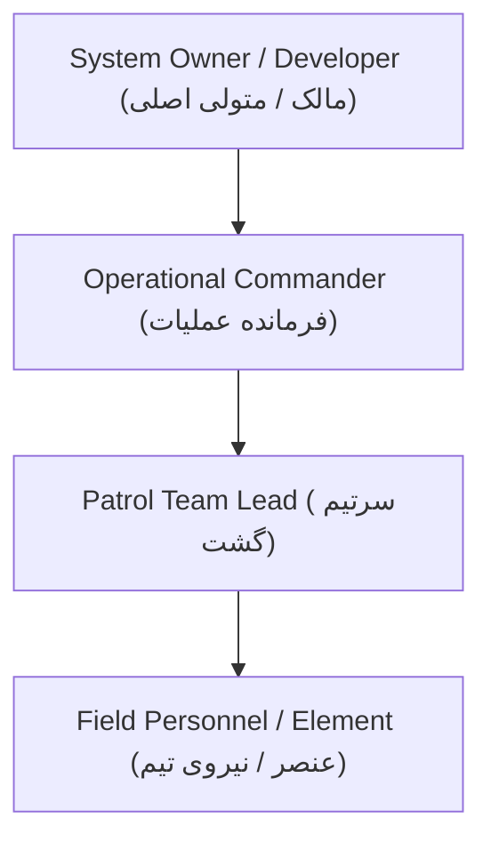
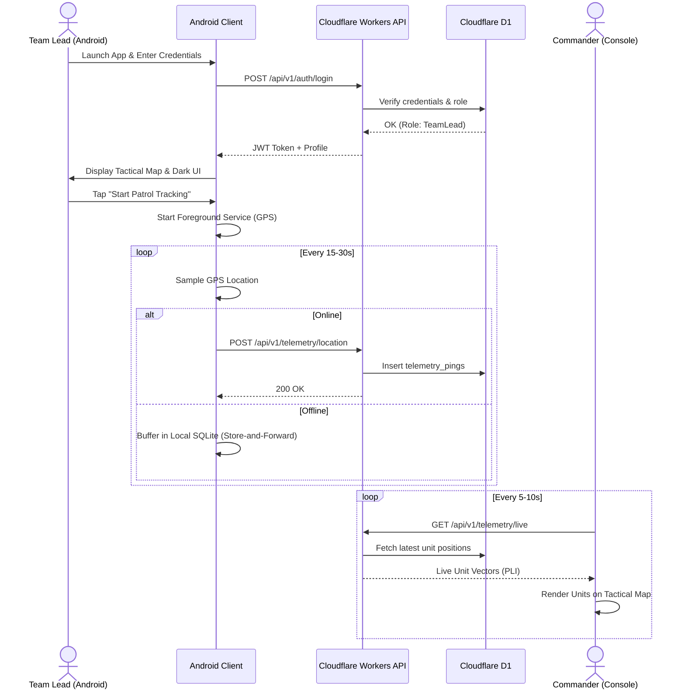
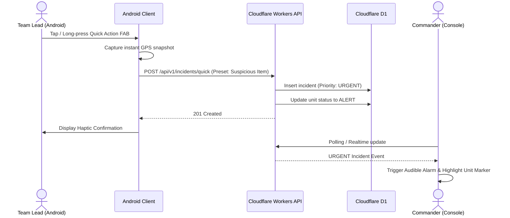

# WayMate — Requirements Specification (SRS)

## 1. Document Overview and Scope

### 1.1 Project Purpose
**WayMate** is a tactical field operations and situational awareness system designed to provide real-time location management of operational personnel, environmental monitoring, remote tactical guidance, and coordinated field response. Originally inspired by tactical Blue Force Tracking (BFT) systems such as ATAK (Android Team Awareness Kit), WayMate adapts these capabilities into a lightweight, sovereign, and cost-efficient architecture running over national/intranet networks with an Android client and a Cloudflare serverless backend.

### 1.2 Document Scope
This document captures all functional, non-functional, security, and architectural requirements derived from authoritative project documentation. It establishes traceability from source material to formal engineering requirements, resolves terminological ambiguities, defines user roles and workflows, and categorizes requirements into prioritized implementation tiers (P0/MVP, P1, P2, and Blocked).

---

## 2. Source Inventory and Traceability Rules

### 2.1 Authoritative Sources
The requirements in this specification are grounded in the following primary source documents:

1. **[سند پروژه.md](file:///E:/2.Things/Android-Projects/WayMate/docs/sources/%D8%B3%D9%86%D8%AF%20%D9%BE%D8%B1%D9%88%DA%98%D9%87.md)** (*Operational and Technical System Requirements Document v1.0*):
   - Primary operational requirements baseline covering system goals, network infrastructure, client capabilities, command hierarchy, tracking, geofencing, local data security, UI/UX, and administrative capabilities.
2. **[قابلیت اجرایی شدن پروژه.md](file:///E:/2.Things/Android-Projects/WayMate/docs/sources/%D9%82%D8%A7%D8%A8%D9%84%DB%8C%D8%AA%20%D8%A7%D8%AC%D8%B1%D8%A7%DB%8C%DB%8C%20%D8%B4%D8%AF%D9%86%20%D9%BE%D8%B1%D9%88%DA%98%D9%87.md)** (*Project Technical Feasibility Assessment*):
   - Practical engineering analysis assessing solo-developer/AI-augmented feasibility, scope management, phase breakdown, and field operational risks.
3. **[Atak.txt](file:///E:/2.Things/Android-Projects/WayMate/docs/sources/Atak.txt)** (*ATAK Platform Reference Notes*):
   - Benchmark reference describing Cursor-on-Target (CoT), Position Location Information (PLI), offline MBTiles/GeoTIFF maps, and 9-Line emergency actions.
4. **[AGENTS.md](file:///E:/2.Things/Android-Projects/WayMate/AGENTS.md)** (*Agent Instructions and Architectural Boundaries*):
   - Strict architectural guidelines: Android Kotlin + Jetpack Compose, Cloudflare Workers + D1 backend, exclusion of Cloudflare R2, zero hardcoded credentials, test verification rules.
5. **[docs/architecture.md](file:///E:/2.Things/Android-Projects/WayMate/docs/architecture.md)** (*WayMate Architecture Baseline*):
   - High-level system design principles, separation of concerns, and pending technology decisions.
6. **[todo.md](file:///E:/2.Things/Android-Projects/WayMate/todo.md)** (*Project Roadmap & Phase Tracking*):
   - Granular breakdown of implementation phases from Phase 0 to Phase 15.

### 2.2 Traceability Identification Scheme
- `REQ-F-xxx`: Functional Requirement
- `REQ-NF-xxx`: Non-Functional Requirement
- Every requirement records:
  - **Requirement ID**: Unique stable identifier.
  - **Source Citation**: Document title and section.
  - **Classification**: `Explicit Source Requirement` vs `Proposed Engineering Specification`.
  - **Priority**: `P0` (MVP), `P1` (Phase 2), `P2` (Advanced/Phase 3), or `Blocked` (Pending external decision).

---

## 3. User Roles, Actors, and Permissions

Based on *سند پروژه.md (Section 3.ب)*, the system enforces a strict hierarchical Role-Based Access Control (RBAC) model.

### 3.1 Role Definitions

| Role | Classification | Responsibilities & Permitted Actions | Excluded Actions |
| :--- | :--- | :--- | :--- |
| **System Owner / Developer** *(مالک / متولی اصلی سامانه)* | Explicit Source Requirement | - System-level provisioning and configuration. - Creates and manages Commander accounts. - Uploads baseline system-wide tactical layers and maps. - Reviews system-wide audit logs and infrastructure health. | Does not micromanage tactical field teams during live operations unless designated as a Commander. |
| **Operational Commander** *(فرمانده عملیات)* | Explicit Source Requirement | - Defines, provisions, and manages patrol teams and subordinate units. - Views live real-time positions (PLI) and historical breadcrumb trails. - Configures missions, operating time windows, and geofences. - Defines tactical map layers (sensitive points, patrol routes, hazard zones). - Monitors communication health and receives emergency alerts. - Dispatches internal tactical notifications and check-in prompts. | Cannot reconfigure underlying server infrastructure or alter system ownership credentials. |
| **Patrol Team Lead** *(سرتیم گشتی)* | Explicit Source Requirement | - Operates the WayMate Android application in the field. - Transmits continuous GPS coordinates (automated). - Updates operational status (`Normal`, `Pursuing`, `Engaged`). - Triggers the Quick Action floating emergency button. - Submits structured incident reports (with offline queueing). - Toggles visibility of assigned tactical map layers. - Responds to commander check-in requests. | Cannot view or modify teams outside their assigned mission/command scope; cannot edit mission parameters. |
| **Field Element / Personnel** *(عنصر / نیروی تیم)* | Explicit Source Requirement | - Passive team member deployed alongside the Team Lead. - Does **not** require an app installation (per *سند پروژه.md 3.ب*). - Metadata (name, role, assigned equipment, vehicle) is registered under the Team Lead's unit by the Commander. | Does not interact directly with the client app. |

---

## 4. Functional Requirements

### 4.1 Identity, Authentication & Access Control

#### `REQ-F-001`: User Authentication & Session Management
- **Source**: *سند پروژه.md (3.ب)*, *docs/architecture.md (Section 5)*.
- **Classification**: Explicit Source Requirement.
- **Priority**: **P0 (MVP)**.
- **Description**: The system must provide secure user authentication for Commanders and Team Leads using unique credentials (username/identifier and password/passphrase). Sessions must be maintained via signed cryptographic tokens (e.g. JWT) with automatic expiration and revocation support.
- **Inputs**: Username, password, client device identifier.
- **Outputs**: Authentication session token, user profile, role, and permission scope.
- **Acceptance Criteria**:
  - Invalid credentials return an HTTP 401 error with a generic error message.
  - Successfully authenticated users receive a scoped token valid for backend API interactions.
  - Expired tokens are rejected by all protected API endpoints.

#### `REQ-F-002`: Role-Based Access Control (RBAC) Enforcement
- **Source**: *سند پروژه.md (3.ب — سیستم نقش‌ها و مجوزهای دقیق‌تر)*.
- **Classification**: Explicit Source Requirement.
- **Priority**: **P0 (MVP)**.
- **Description**: The system must enforce authorization checks on both the server API and client interface. Field units (Team Leads) are strictly restricted to telemetry transmission, incident reporting, and viewing their assigned tactical layers. Only Commanders can access team positions, mission configurations, and tactical layer management.
- **Inputs**: Authenticated request with user context.
- **Outputs**: Authorized resource response or HTTP 403 Forbidden.
- **Acceptance Criteria**:
  - A Team Lead attempting to fetch other teams' location history or edit team metadata receives HTTP 403.
  - Commander endpoints require the `Commander` or `Owner` role claim.

---

### 4.2 Organizational Hierarchy & Team Management

#### `REQ-F-003`: Commander & Team Provisioning
- **Source**: *سند پروژه.md (3.ب)*.
- **Classification**: Explicit Source Requirement.
- **Priority**: **P0 (MVP)**.
- **Description**: The Owner can create and manage Commander accounts. Commanders can create Patrol Teams, designate the Team Lead (app user), and record team metadata including personnel names, assigned tactical gear/equipment, and vehicle specifications.
- **Inputs**: Team name, designated Team Lead username, member roster, equipment list, vehicle identifier/type.
- **Outputs**: Created team record linked to the Commander's hierarchy.
- **Acceptance Criteria**:
  - The Commander can view the complete roster of their assigned teams.
  - Each team is mapped to exactly one active primary Team Lead device account.

---

### 4.3 Real-Time Location Tracking & Situational Awareness (PLI)

#### `REQ-F-004`: Automated GPS Telemetry Acquisition & Transmission
- **Source**: *سند پروژه.md (3.ج — پایش زنده و وضعیت‌شناسی)*, *Atak.txt (بند ۵)*.
- **Classification**: Explicit Source Requirement.
- **Priority**: **P0 (MVP)**.
- **Description**: The Android app must periodically acquire precise GPS coordinates (latitude, longitude, altitude, accuracy, heading, speed, and UTC timestamp) and transmit them to the backend API while in active tracking mode.
- **Inputs**: Device GPS hardware updates.
- **Outputs**: Telemetry packet dispatched to the backend API (`/api/v1/telemetry/location`).
- **Acceptance Criteria**:
  - In active mode with GPS lock, location updates are captured and transmitted at the configured frequency (e.g., every 10–30 seconds during active patrol).
  - Telemetry payload includes latitude, longitude, accuracy (in meters), speed, bearing, device timestamp, and current operational status.

#### `REQ-F-005`: Field Unit Operational Status Selection
- **Source**: *سند پروژه.md (3.ج)*.
- **Classification**: Explicit Source Requirement.
- **Priority**: **P0 (MVP)**.
- **Description**: The field application must allow the Team Lead to quickly select and update their operational status among predefined tactical states:
  1. `Normal` (*عادی*)
  2. `Pursuing` (*در حال تعقیب*)
  3. `Engaged / In Confrontation` (*درگیر با مورد*)
  4. Custom states defined by doctrine.
  The selected status must accompany every location packet and immediately update the Commander's map display.
- **Inputs**: User UI selection of status.
- **Outputs**: Updated status packet transmitted to backend.
- **Acceptance Criteria**:
  - Changing status in the UI takes no more than 2 taps.
  - The latest status is transmitted immediately without waiting for the next periodic location interval.

#### `REQ-F-006`: Commander Real-Time Blue Force Map View
- **Source**: *سند پروژه.md (3.ج)*, *Atak.txt (بند ۵)*.
- **Classification**: Explicit Source Requirement.
- **Priority**: **P0 (MVP)**.
- **Description**: The system must provide Commanders with a map interface showing the real-time position, heading, velocity, and operational status of all active subordinate units.
- **Inputs**: Query to `/api/v1/telemetry/live`.
- **Outputs**: Visual map markers with color-coded operational status and unit callsign.
- **Acceptance Criteria**:
  - Markers update dynamically based on fresh location pings.
  - Clicking a unit marker displays unit details (callsign, Team Lead name, speed, accuracy, last ping timestamp, and operational status).

#### `REQ-F-007`: Historical Digital Breadcrumb Trails
- **Source**: *سند پروژه.md (3.ج — ردپای دیجیتال)*.
- **Classification**: Explicit Source Requirement.
- **Priority**: **P1 (Phase 2)**.
- **Description**: The system must store historical coordinate sequences and allow Commanders to reconstruct and visualize the exact route traveled by any team during a specified time window.
- **Inputs**: Team ID, start timestamp, end timestamp.
- **Outputs**: Polyline geometry rendered on the tactical map with directional waypoints.
- **Acceptance Criteria**:
  - Commander can select a past mission window and view the historical track as an overlay on the map.

#### `REQ-F-008`: Adaptive Location Frequency & Battery Optimization
- **Source**: *سند پروژه.md (3.ج)*.
- **Classification**: Explicit Source Requirement.
- **Priority**: **P1 (Phase 2)**.
- **Description**: The client app must dynamically adjust GPS sampling and transmission intervals based on motion state (e.g. stationary vs walking vs vehicle movement) to minimize battery depletion and cellular data overhead.
- **Inputs**: Accelerometer/activity recognition signals, displacement threshold.
- **Outputs**: Adaptive polling interval (e.g., 60s when stationary, 10s when moving).
- **Acceptance Criteria**:
  - When device displacement remains < 10 meters over 3 minutes, transmission rate throttles down to save battery.

---

### 4.4 Tactical Mapping & Layer Management

#### `REQ-F-009`: Base Map Display (OpenStreetMap)
- **Source**: *سند پروژه.md (3.الف)*.
- **Classification**: Explicit Source Requirement.
- **Priority**: **P0 (MVP)**.
- **Description**: The Android app must render an interactive vector/raster base map using OpenStreetMap (OSM) tile sources. The map must support pan, zoom, rotation, and current user location centering.
- **Inputs**: OSM tile server endpoint, device location coordinates.
- **Outputs**: Interactive map canvas in Compose.
- **Acceptance Criteria**:
  - Map loads and renders tiles smoothly at zoom levels 1 to 18.
  - When location permission is granted, a "My Location" reticle centers the view on the user.

#### `REQ-F-010`: Tactical Overlays & POI Layers
- **Source**: *سند پروژه.md (3.الف — مدیریت لایه‌های تاکتیکی)*.
- **Classification**: Explicit Source Requirement.
- **Priority**: **P1 (Phase 2)**.
- **Description**: The system must allow Commanders to create and broadcast tactical layers, including:
  - Critical/Sensitive Points (*مراکز و نقاط حساس*)
  - Patrol Routes (*مسیرهای گشتی*)
  - Hazard/Contaminated Zones (*نقاط آلوده*)
  Field personnel can independently toggle layer visibility on their map.
- **Inputs**: GeoJSON/vector layer definitions created by Commander.
- **Outputs**: Styled point, line, and polygon overlays on the map.
- **Acceptance Criteria**:
  - Field user can open a layer drawer and toggle individual tactical layers on/off.

#### `REQ-F-011`: Offline Map Tile Caching
- **Source**: *سند پروژه.md (3.الف — تایل‌های آفلاین)*, *Atak.txt (بند ۴)*.
- **Classification**: Explicit Source Requirement.
- **Priority**: **P1 (Phase 2)**.
- **Description**: The client must support downloading and locally storing map tile packages (e.g., MBTiles or directory tile caches) for a defined geographic bounding box, allowing full map display when network connectivity is lost.
- **Inputs**: Downloadable map bounding box or pre-packaged local archive.
- **Outputs**: Seamless map rendering offline from local storage.
- **Acceptance Criteria**:
  - With airplane mode enabled, cached bounding box renders all zoom levels up to zoom 16 without network requests.

---

### 4.5 Emergency Alerts & Incident Reporting

#### `REQ-F-012`: Quick Action Emergency Floating Button
- **Source**: *سند پروژه.md (4.ب — دکمه عملیات فوری)*, *Atak.txt (بند ۶)*.
- **Classification**: Explicit Source Requirement.
- **Priority**: **P0 (MVP)**.
- **Description**: The field app must feature a persistent, high-contrast floating action button (FAB) that immediately transmits an urgent incident alert with current GPS coordinates and timestamp upon a single confirmed action (or tap-and-hold to prevent accidental triggers). The default preset alert corresponds to "Suspicious item/situation spotted" (*مورد مشکوک رویت شد*).
- **Inputs**: User tap / long-press on Quick Action button.
- **Outputs**: Immediate high-priority HTTP POST to `/api/v1/incidents/quick`.
- **Acceptance Criteria**:
  - Activation requires ≤ 1 second from any screen.
  - Server immediately registers the alert and marks the unit as high-priority alert status.
  - If network is unavailable, alert is queued in offline buffer and marked pending.

#### `REQ-F-013`: Structured Incident Reporting
- **Source**: *سند پروژه.md (4.ج — سیستم گزارش‌دهی ساختاریافته)*.
- **Classification**: Explicit Source Requirement.
- **Priority**: **P0 (MVP)**.
- **Description**: The field app must provide a standard form for recording tactical incidents, capturing:
  - Incident Category/Type (e.g., Suspicious Activity, Trespassing, Hazard, Medical, Equipment Failure)
  - Textual description / remarks
  - Precise GPS coordinates (auto-populated with manual override capability)
  - Incident timestamp
  In high-stress situations, the user can submit a minimal report with just type and location, deferring full details.
- **Inputs**: Form inputs from field user.
- **Outputs**: Structured incident record stored on backend and visible to Commander.
- **Acceptance Criteria**:
  - Form validates required fields (type and location).
  - Submission succeeds online and queues gracefully offline.

---

### 4.6 Communications, Notifications & Monitoring

#### `REQ-F-014`: Communication Health Monitoring
- **Source**: *سند پروژه.md (3.ج — سیستم ثبت سلامت ارتباط)*.
- **Classification**: Explicit Source Requirement.
- **Priority**: **P0 (MVP)**.
- **Description**: The backend must track the health of each field unit's link by recording the timestamp of the last received ping, current connection state (`Online`, `Stale`, `Offline`), and queue health. Units with no telemetry received within a configurable threshold (e.g. > 3 minutes) are visually flagged on the Commander's console.
- **Inputs**: Periodic telemetry pings and heartbeats.
- **Outputs**: Connection health indicator on unit markers and roster.
- **Acceptance Criteria**:
  - A unit that has transmitted within the last 60 seconds is marked green (`Online`).
  - A unit with no transmission for > 180 seconds transitions to amber/red (`Stale` / `Disconnected`).

#### `REQ-F-015`: Internal Tactical Notifications
- **Source**: *سند پروژه.md (4.د — سیستم اعلان داخلی)*.
- **Classification**: Explicit Source Requirement.
- **Priority**: **P0 (MVP)**.
- **Description**: The system must provide an internal messaging/announcement channel between Commanders and Field Teams for mission updates, operational alerts, and status changes without relying on third-party commercial push services (e.g. Google Firebase Cloud Messaging, which is unsuitable for closed/national intranet environments).
- **Inputs**: Commander message dispatch via API.
- **Outputs**: Notification banner/dialog in the Android application.
- **Acceptance Criteria**:
  - Messages sent by Commander are fetched via active polling or real-time channel and displayed in the field app.

#### `REQ-F-016`: Scheduled Presence Check-in
- **Source**: *سند پروژه.md (3.ج — سیستم چک‌این دوره‌ای)*.
- **Classification**: Explicit Source Requirement.
- **Priority**: **P1 (Phase 2)**.
- **Description**: Commanders can schedule periodic check-ins. When triggered, the field app prompts the Team Lead to acknowledge presence with a single tap, capturing current timestamp and GPS coordinates.
- **Inputs**: Scheduled check-in trigger from server.
- **Outputs**: Check-in acknowledgment packet with GPS stamp.
- **Acceptance Criteria**:
  - Field app displays an audible/vibrating check-in modal.
  - Acknowledgment registers in the backend and logs in the mission timeline.

---

### 4.7 Tactical Boundaries & Geofencing

#### `REQ-F-017`: Geofence Boundary Definition & Automated Alerts
- **Source**: *سند پروژه.md (3.د — حصار جغرافیایی)*, *Atak.txt (بند ۶)*.
- **Classification**: Explicit Source Requirement.
- **Priority**: **P1 (Phase 2)**.
- **Description**: Commanders can define polygon or circular geofences. The server automatically evaluates incoming unit coordinates against active geofences and generates an automated alert if a unit breaches or leaves an assigned operating boundary.
- **Inputs**: Geofence polygon vertices, unit coordinate stream.
- **Outputs**: Geofence breach event and notification to Commander.
- **Acceptance Criteria**:
  - Unit coordinate outside polygon boundary immediately generates a `GEOFENCE_EXIT` alert.

---

### 4.8 Offline Resiliency & Storage

#### `REQ-F-018`: Store-and-Forward Offline Telemetry & Report Buffer
- **Source**: *سند پروژه.md (3.ج — ذخیره‌سازی آفلاین و بازپخش تاب‌آور داده‌ها)*.
- **Classification**: Explicit Source Requirement.
- **Priority**: **P0 (MVP — Core Buffer)** / **P1 (Full Bulk Replay)**.
- **Description**: When cellular/intranet connection is lost, all location pings, status changes, quick alerts, and incident reports must be stored in a local SQLite database queue. Upon network restoration, the queue must automatically flush and replay events in chronological order to the backend.
- **Inputs**: Outgoing telemetry/reports during network disconnection.
- **Outputs**: Synchronized backend records with original capture timestamps preserved.
- **Acceptance Criteria**:
  - Disconnecting network, performing 5 location pings and 1 incident report, and reconnecting network results in all 6 items arriving at the backend with original capture timestamps intact.

#### `REQ-F-019`: Encrypted Local Storage
- **Source**: *سند پروژه.md (3.هـ — امنیت اطلاعات محلی)*.
- **Classification**: Explicit Source Requirement.
- **Priority**: **P1 (Phase 2)**.
- **Description**: All locally cached sensitive data on the Android device (buffered telemetry, offline incident reports, cached mission rosters, authentication tokens) must be encrypted at rest using AES-256 (e.g. SQLCipher / Android EncryptedSharedPreferences / Jetpack Security).
- **Inputs**: Plaintext data to be persisted.
- **Outputs**: AES-256 encrypted bytes on disk; keys managed via Android Keystore.
- **Acceptance Criteria**:
  - Physical inspection of database file on rooted device yields no plaintext coordinates or credentials.

---

### 4.9 Governance, Audit & Analytics

#### `REQ-F-020`: System Audit Logging
- **Source**: *سند پروژه.md (3.ب — ثبت تاریخچه تغییرات سامانه)*.
- **Classification**: Explicit Source Requirement.
- **Priority**: **P1 (Phase 2)**.
- **Description**: The backend must record an immutable audit log of administrative and operational mutations: user creation/deletion, team assignment, mission activation, geofence updates, and security setting modifications.
- **Inputs**: User ID, action type, entity ID, payload diff, IP address, timestamp.
- **Outputs**: Queryable audit records in Cloudflare D1.
- **Acceptance Criteria**:
  - Any administrative mutation generates an audit row. Regular users cannot delete or truncate audit logs.

#### `REQ-F-021`: Operational Analytics Dashboard
- **Source**: *سند پروژه.md (5 — داشبورد آماری عملیاتی)*.
- **Classification**: Explicit Source Requirement.
- **Priority**: **P1 (Phase 2)**.
- **Description**: The Commander interface must present summarized operational metrics: count of active units, online/offline ratio, total incidents reported today, average response times, and mission completion stats.
- **Inputs**: Aggregated queries against Cloudflare D1.
- **Outputs**: Tabular and chart summaries for command decision-making.
- **Acceptance Criteria**:
  - Dashboard renders operational metrics updated within the last 60 seconds.

---

### 4.10 Deferred / High-Risk Architectural Capabilities

#### `REQ-F-022`: Peer-to-Peer / Local Mesh Relay (DEFERRED)
- **Source**: *سند پروژه.md (2 — قابلیت همگام‌سازی و رله منطقه‌ای پیام‌ها)*, *قابلیت اجرایی شدن پروژه.md (بخش ۱)*.
- **Classification**: Explicit Source Requirement (Deferred per Feasibility Assessment).
- **Priority**: **P2 / Blocked (Phase 3)**.
- **Description**: Direct peer-to-peer ad-hoc communication (e.g. Wi-Fi Direct or Bluetooth mesh) between nearby phones to daisy-chain telemetry in network blind spots.
- **Rationale for Deferral**: The feasibility assessment explicitly designates P2P mesh relay as the highest-risk, multi-month endeavor with severe device fragmentation, battery drain, routing complexity, and security vulnerabilities. It is formally excluded from the MVP.

---

## 5. Non-Functional Requirements

### 5.1 Security & Authorization (`REQ-NF-SEC`)

#### `REQ-NF-001`: Server-Side Authorization Enforcement
- **Source**: *AGENTS.md*, *docs/architecture.md*.
- **Classification**: Explicit Project Rule.
- **Requirement**: Authorization must be validated on every Cloudflare Worker endpoint. The system must never rely on client-side UI hiding for security.

#### `REQ-NF-002`: Zero Hardcoded Secrets & Credential Sanitation
- **Source**: *AGENTS.md*, *README.md*.
- **Classification**: Explicit Project Rule.
- **Requirement**: No API tokens, private keys, database passwords, or machine-specific paths may be committed to source control or embedded in client binaries. Sensitive runtime parameters must be injected via environment variables or Cloudflare Worker secrets.

#### `REQ-NF-003`: Transport Layer Security
- **Source**: *سند پروژه.md (2)*.
- **Classification**: Explicit Source Requirement.
- **Requirement**: All communication between Android clients and Cloudflare Workers must be encrypted in transit using TLS 1.3 over HTTPS/WSS.

---

### 5.2 Privacy, Consent & Location Visibility (`REQ-NF-PRIV`)

#### `REQ-NF-004`: Explicit Location Tracking State & User Notice
- **Source**: *AGENTS.md*, *Android CDD / Platform Guidelines*.
- **Classification**: Explicit Project Rule.
- **Requirement**: The Android app must prominently display when location tracking is active via an in-app visual indicator (e.g. pulsing green badge / status banner) and a persistent Android Foreground Service notification. The user must retain the ability to pause or stop tracking.

#### `REQ-NF-005`: Minimal Location Permission Scoping
- **Source**: *AGENTS.md*.
- **Classification**: Explicit Project Rule.
- **Requirement**: Location permission (`ACCESS_FINE_LOCATION`, `ACCESS_COARSE_LOCATION`, `ACCESS_BACKGROUND_LOCATION`) must be requested incrementally with a clear in-app rationale explaining operational necessity.

---

### 5.3 Battery, Performance & Network Resiliency (`REQ-NF-PERF`)

#### `REQ-NF-006`: Battery Consumption Budget
- **Source**: *سند پروژه.md (3.ج)*, *قابلیت اجرایی شدن پروژه.md (بخش ۳)*.
- **Classification**: Proposed Engineering Standard.
- **Requirement**: Under continuous tracking during an 8-hour shift, the app's battery drain must not exceed 4% per hour on standard Android hardware (4,000+ mAh battery) using balanced GPS sampling and foreground service execution.

#### `REQ-NF-007`: Low-Bandwidth Network Optimization
- **Source**: *سند پروژه.md (2)*, *Atak.txt (بند ۵)*.
- **Classification**: Explicit Source Requirement.
- **Requirement**: Individual location telemetry payloads must be compact (< 500 bytes uncompressed JSON, or binary encoded) to operate reliably over constrained national 2G/3G intranet connections.

---

### 5.4 Usability & UI/UX Standards (`REQ-NF-UX`)

#### `REQ-NF-008`: Dark Tactical UI Theme
- **Source**: *سند پروژه.md (4.الف — طراحی تیره و تاکتیکی)*.
- **Classification**: Explicit Source Requirement.
- **Requirement**: The application must default to a high-contrast dark theme (OLED true dark / deep charcoal background) to minimize light projection onto the operator's face during night operations and preserve tactical concealment.

#### `REQ-NF-009`: Persian (Farsi) & Right-to-Left (RTL) First-Class Support
- **Source**: *سند پروژه.md*, *todo.md (مرحله ۳)*.
- **Classification**: Explicit Source Requirement.
- **Requirement**: All UI components, typography, layout mirroring, dialogs, and navigation flows must fully support Persian localization and native RTL layout direction.

---

## 6. End-to-End System Workflows

### 6.1 Workflow 1: Field Unit Patrol Activation & Live Tracking (MVP Core)

### 6.2 Workflow 2: Quick Action Emergency Alert (MVP Core)

---

## 7. System Responsibility Matrix

| Capability / Responsibility | Android Client (Kotlin / Compose) | Backend API (Cloudflare Workers) | Database (Cloudflare D1) | Mapping Engine / Provider |
| :--- | :--- | :--- | :--- | :--- |
| **Authentication & Tokens** | Stores token securely; attaches Bearer header. | Validates credentials; issues and verifies JWT. | Stores hashed credentials (`users` table). | N/A |
| **GPS Acquisition** | FusedLocationProvider / Foreground Service. | N/A | N/A | N/A |
| **Telemetry Ingestion** | Dispatches periodic location pings. | Validates payload bounds & rate limits. | Appends row to `telemetry_pings`. | N/A |
| **Live Unit Retrieval** | In Commander view: renders unit markers. | Serves `/api/v1/telemetry/live`. | Queries latest position per unit. | MapLibre / osmdroid renders markers. |
| **Base Map Tiles** | Renders tiles on Compose canvas. | Optional caching proxy (if intranet). | N/A | OpenStreetMap tile servers / local MBTiles. |
| **Tactical Layers** | Toggles layer visibility in UI. | Serves GeoJSON layer definitions. | Stores layer geometry in D1. | Renders vector features on map. |
| **Quick Action & Incidents** | Captures GPS, presents incident form. | Validates, prioritizes, and timestamps. | Stores incident records (`incidents` table). | Displays incident pin at coordinates. |
| **Offline Buffering** | Local Room/SQLite Store-and-Forward queue. | Idempotent bulk ingestion endpoint. | Batch inserts queued records. | N/A |
| **Internal Messaging** | Displays notifications / banners. | Routes messages between roles. | Stores message records (`messages` table). | N/A |
| **Geofencing Evaluation** | Optional local breach warning. | Evaluates coordinates vs polygon bounds. | Stores geofence vertices (`geofences` table).| Renders geofence polygon on map. |

---

## 8. Requirements Traceability Matrix & Prioritization Summary

| ID | Title | Source Document Reference | Category | Priority |
| :--- | :--- | :--- | :--- | :--- |
| `REQ-F-001` | User Authentication & Session Management | *سند پروژه.md (3.ب)* | Auth | **P0 (MVP)** |
| `REQ-F-002` | Role-Based Access Control (RBAC) | *سند پروژه.md (3.ب)* | Auth | **P0 (MVP)** |
| `REQ-F-003` | Commander & Team Hierarchy Management | *سند پروژه.md (3.ب)* | Hierarchy | **P0 (MVP)** |
| `REQ-F-004` | Automated GPS Telemetry Acquisition & Uplink | *سند پروژه.md (3.ج)*, *Atak.txt (5)* | Telemetry | **P0 (MVP)** |
| `REQ-F-005` | Field Unit Operational Status Selection | *سند پروژه.md (3.ج)* | Telemetry | **P0 (MVP)** |
| `REQ-F-006` | Commander Real-Time Blue Force Map View | *سند پروژه.md (3.ج)*, *Atak.txt (5)* | Situational Awareness | **P0 (MVP)** |
| `REQ-F-007` | Historical Digital Breadcrumb Trails | *سند پروژه.md (3.ج)* | History | **P1** |
| `REQ-F-008` | Adaptive Location Frequency & Battery Tuning | *سند پروژه.md (3.ج)* | Optimization | **P1** |
| `REQ-F-009` | Base Map Display (OpenStreetMap) | *سند پروژه.md (3.الف)* | GIS | **P0 (MVP)** |
| `REQ-F-010` | Tactical Overlays & POI Layers | *سند پروژه.md (3.الف)* | GIS | **P1** |
| `REQ-F-011` | Offline Map Tile Caching (MBTiles) | *سند پروژه.md (3.الف)*, *Atak.txt (4)* | GIS | **P1** |
| `REQ-F-012` | Quick Action Emergency Floating Button | *سند پروژه.md (4.ب)*, *Atak.txt (6)* | Alert | **P0 (MVP)** |
| `REQ-F-013` | Structured Incident Reporting Form | *سند پروژه.md (4.ج)* | Incidents | **P0 (MVP)** |
| `REQ-F-014` | Communication Health & Link Status | *سند پروژه.md (3.ج)* | Telemetry | **P0 (MVP)** |
| `REQ-F-015` | Internal Tactical Notifications | *سند پروژه.md (4.د)* | Messaging | **P0 (MVP)** |
| `REQ-F-016` | Scheduled Presence Check-in | *سند پروژه.md (3.ج)* | Monitoring | **P1** |
| `REQ-F-017` | Geofence Boundary Definition & Alerts | *سند پروژه.md (3.د)*, *Atak.txt (6)* | Perimeter | **P1** |
| `REQ-F-018` | Store-and-Forward Offline Telemetry Buffer | *سند پروژه.md (3.ج)* | Resiliency | **P0 (MVP)** |
| `REQ-F-019` | Encrypted Local Storage (AES-256) | *سند پروژه.md (3.هـ)* | Security | **P1** |
| `REQ-F-020` | System Audit Logging | *سند پروژه.md (3.ب)* | Governance | **P1** |
| `REQ-F-021` | Operational Analytics Dashboard | *سند پروژه.md (5)* | Analytics | **P1** |
| `REQ-F-022` | Peer-to-Peer / Local Mesh Relay | *سند پروژه.md (2)* | Mesh Comms | **P2 / Blocked** |
| `REQ-NF-001`| Server-Side Authorization Enforcement | *AGENTS.md*, *docs/architecture.md* | Security | **P0 (MVP)** |
| `REQ-NF-002`| Zero Hardcoded Secrets | *AGENTS.md*, *README.md* | Security | **P0 (MVP)** |
| `REQ-NF-003`| Transport Encryption (TLS 1.3) | *سند پروژه.md (2)* | Security | **P0 (MVP)** |
| `REQ-NF-004`| Explicit Location Tracking Notification | *AGENTS.md* | Privacy | **P0 (MVP)** |
| `REQ-NF-005`| Incremental Location Permission Model | *AGENTS.md* | Privacy | **P0 (MVP)** |
| `REQ-NF-006`| Battery Drain Limits (<4%/hour) | *سند پروژه.md (3.ج)* | Performance | **P1** |
| `REQ-NF-007`| Low-Bandwidth Telemetry (<500B/packet) | *سند پروژه.md (2)* | Performance | **P0 (MVP)** |
| `REQ-NF-008`| Dark Tactical UI Theme | *سند پروژه.md (4.الف)* | Usability | **P0 (MVP)** |
| `REQ-NF-009`| Persian (Farsi) & RTL Layout Support | *سند پروژه.md*, *todo.md* | Localization | **P0 (MVP)** |

---

## 9. Open Questions and Clarification Requirements

The following architectural questions require formal confirmation from the project owner:

1. **Commander Interface Format**:
   - *Question*: Should the Commander interface be implemented initially as a dedicated tablet/phone screen within the Android application, or as a lightweight Web Single Page App (SPA) served by Cloudflare Workers/Pages?
   - *Impact*: Affects whether the Commander dashboard is built in Jetpack Compose or HTML/Web.
2. **Real-Time Delivery Protocol**:
   - *Question*: For the MVP, is short-interval REST polling (e.g., 5-second interval) acceptable for Commander map updates, or is WebSocket/Server-Sent Events (SSE) strictly required?
   - *Impact*: Affects whether Cloudflare Workers operates purely statelessly or requires Durable Objects / WebSockets.
3. **Map SDK Selection**:
   - *Question*: Which map rendering library should be integrated into Compose (MapLibre Android SDK vs osmdroid)?
   - *Impact*: Affects dependency footprint, vector vs raster rendering, and MBTiles loading.
