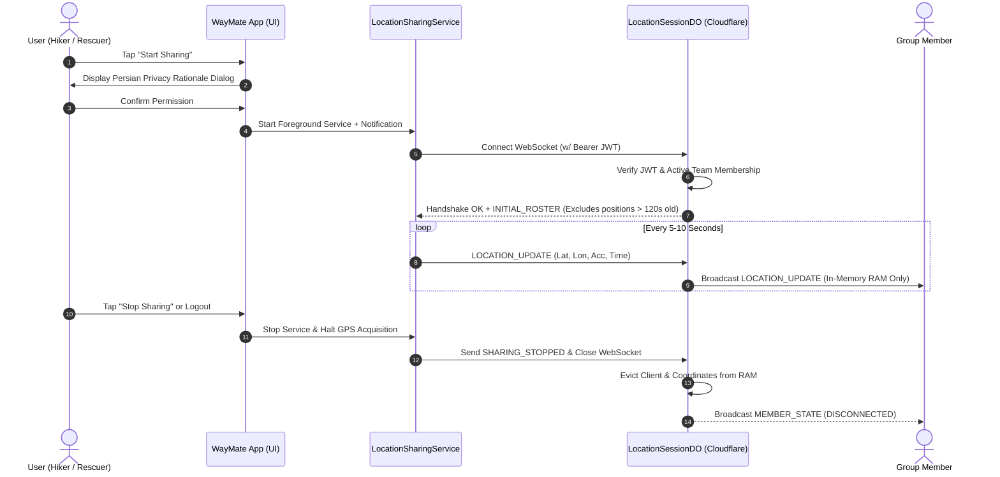

# WayMate — Security and Privacy Architecture & Hardening Guide

> **Document Version:** 1.0.0 (Phase 12 Hardening)  
> **Status:** Production Verified  
> **Target Scope:** Android Client (`ir.alifaniani.waymate`) & Cloudflare Workers Backend (`waymate-backend`)

---

## 1. Executive Summary

WayMate is an offline-first hiking and tactical group coordination platform designed for search and rescue operations, guided excursions, and team navigation in austere environments. Because users exchange sensitive real-time GPS locations, tactical instructions, and operational statuses, security and privacy are treated as core system invariants rather than ancillary features.

Phase 12 implements defense-in-depth protections across both the Android client and the Cloudflare Workers edge backend. This document provides the complete threat model, permission inventory, endpoint authorization matrix, cryptographic specifications, local storage protections, data lifecycle policies, and automated verification evidence.

---

## 2. Threat Model & Mitigation Strategy

| Threat Vector | Potential Impact | Severity | Implemented Mitigation |
| :--- | :--- | :--- | :--- |
| **Unauthenticated API Access** | Data harvesting, rogue command injection | Critical | Global `authMiddleware` enforcing HS256 JWT verification on all non-public endpoints with 401 Unauthorized rejection. |
| **JWT Algorithm Confusion** | Forged administrative access via `alg: "none"` or mismatched asymmetric keys | Critical | Strict JWT header enforcement in `verifyJwt()` requiring `alg === 'HS256'` and `typ === 'JWT'`. |
| **Cross-Team IDOR (Message Acknowledgment)** | Team A lead acknowledging and suppressing orders intended for Team B | High | Server-side validation on `POST /messages/:id/acknowledge` ensuring `TEAM_LEAD` belongs to the `target_team_id`. |
| **Cross-Team Incident GPS Leakage** | Team Lead viewing incidents and coordinates of other teams | High | Scoped query filtering on `GET /incidents` ensuring `TEAM_LEAD` can only access incidents assigned to their active team. |
| **Brute-Force Credential Stuffing** | Account compromise on `/login` | High | Sliding-window `MemoryRateLimiter` capping failed attempts at 5 requests/minute per IP, returning 429 Too Many Requests with `Retry-After`. |
| **JSON Payload Memory Exhaustion** | Worker CPU/RAM starvation via massive body floods | Medium | Global `bodySizeLimitMiddleware` rejecting any request exceeding 64 KB with 413 Payload Too Large. |
| **Stale Coordinate Snooping** | Late-joining peer seeing old positions of members who have stopped moving or disconnected | Medium | Enforced 120-second coordinate cutoff (`STALE_LOCATION_EXPIRY_MS = 120_000`) in `LocationSessionDO` initial roster generation. |
| **Shared Device Offline Data Leakage** | New user accessing previous user's cached tactical data or queued commands | High | Android `RealAuthRepository.logout()` invokes `offlineStorage.clearAll()`, atomically wiping SQLite cache and store-and-forward queue. |
| **Cloud Backup & Device Extraction** | Extraction of session tokens or cached messages from unencrypted Android device backups | Medium | Custom `data_extraction_rules.xml` and `backup_rules.xml` explicitly excluding `waymate_secure_session.xml` and `waymate_offline.db`. |

---

## 3. Android Permissions & Least Privilege Inventory

WayMate requests only permissions strictly necessary for navigation and foreground live location sharing. No background location (`ACCESS_BACKGROUND_LOCATION`) is declared or requested.

| Permission | Protection Level | Purpose | Justification & User Control |
| :--- | :--- | :--- | :--- |
| `android.permission.INTERNET` | Normal | API and WebSocket synchronization | Required for edge backend communication. |
| `android.permission.ACCESS_NETWORK_STATE` | Normal | Offline detection and connection monitoring | Drives offline store-and-forward queue switching without unnecessary network calls. |
| `android.permission.ACCESS_FINE_LOCATION` | Dangerous | GPS-grade location for real-time map marker | Requested only when user explicitly taps "Start Sharing" or opens live map tracking. Explanatory rationale dialog displayed beforehand. |
| `android.permission.ACCESS_COARSE_LOCATION` | Dangerous | Fallback approximate cell/Wi-Fi location | Paired with fine location for battery optimization and indoor positioning. |
| `android.permission.FOREGROUND_SERVICE` | Normal | Service execution while screen is off | Keeps location sharing active during active hikes when the phone is locked. |
| `android.permission.FOREGROUND_SERVICE_LOCATION` | Normal | Android 14+ typed foreground service | Required by Android platform rules for location-accessing foreground services. |
| `android.permission.POST_NOTIFICATIONS` | Dangerous | Ongoing foreground service notification | Mandates clear, persistent system notification showing that location sharing is currently active with a quick stop action. |

### Permission Safety Rules:
1. **Never Requested on Boot or App Launch:** Permission requests are never triggered on application launch, login, or device restart.
2. **Explicit Opt-in Rationale:** Before requesting location permissions, a Persian dialog explains exactly why location is needed and that it will only be shared with verified group members.
3. **Immediate Service & Session Teardown:** Tapping "Stop Sharing" or logging out immediately invokes `LocationSharingService.stop(context)`, halts GPS polling, and disconnects the WebSocket session.

---

## 4. Backend Endpoint Authorization Matrix

Every backend route is audited and bound to strict role-based access control (RBAC) and team isolation.

| Method | Endpoint | Auth Required | Permitted Roles | Resource Isolation / Rule | Success | Unauthorized | Forbidden |
| :--- | :--- | :--- | :--- | :--- | :--- | :--- | :--- |
| `GET` | `/api/v1/health` | No | Public | Health status only, no sensitive metadata | 200 | — | — |
| `POST` | `/api/v1/auth/login` | No | Public | Rate-limited (5 attempts/min/IP). Validates PBKDF2 hash | 200 | 401 | 429 |
| `GET` | `/api/v1/auth/me` | Yes | All (`OWNER`, `COMMANDER`, `TEAM_LEAD`) | Returns caller profile | 200 | 401 | — |
| `POST` | `/api/v1/auth/logout` | Yes | All | Revokes session audit trace | 200 | 401 | — |
| `GET` | `/api/v1/teams` | Yes | All | Returns active teams | 200 | 401 | — |
| `POST` | `/api/v1/teams` | Yes | `OWNER`, `COMMANDER` | Creates new operational team | 201 | 401 | 403 |
| `PUT` | `/api/v1/teams/:id` | Yes | `OWNER`, `COMMANDER` | Updates team metadata or toggles active state | 200 | 401 | 403 |
| `POST` | `/api/v1/teams/:id/members` | Yes | `OWNER`, `COMMANDER` | Validates active team (`is_active === 1`) and adds member | 201 | 401 | 400 / 403 |
| `DELETE`| `/api/v1/teams/:id/members/:mId` | Yes | `OWNER`, `COMMANDER` | Removes personnel member from roster | 200 | 401 | 403 |
| `GET` | `/api/v1/messages` | Yes | All | Team leads see team-targeted & broadcast messages | 200 | 401 | — |
| `POST` | `/api/v1/messages` | Yes | `OWNER`, `COMMANDER` | Dispatches orders. 64KB body limit, 500 char message | 201 | 401 | 403 / 413 |
| `POST` | `/api/v1/messages/:id/acknowledge` | Yes | All | **IDOR Protected:** `TEAM_LEAD` must belong to `target_team_id` | 200 | 401 | 403 |
| `GET` | `/api/v1/incidents` | Yes | All | **Isolated:** `TEAM_LEAD` sees only own team incidents | 200 | 401 | — |
| `POST` | `/api/v1/incidents` | Yes | All | Creates incident report with GPS coordinates | 201 | 401 | 400 |
| `GET` | `/api/v1/points` | Yes | All | **Isolated:** `TEAM_LEAD` sees only own team POIs | 200 | 401 | — |
| `POST` | `/api/v1/points` | Yes | All | Creates POI for caller's active team | 201 | 401 | 400 / 403 |
| `PUT` | `/api/v1/points/:id` | Yes | All | Optimistic concurrency version check; team scoped | 200 | 401 | 403 / 409 |
| `DELETE`| `/api/v1/points/:id` | Yes | All | Soft-deletes POI; team scoped | 200 | 401 | 403 |
| `GET` | `/api/v1/telemetry/stats` | Yes | All | Operational telemetry summary | 200 | 401 | — |
| `GET` | `/api/v1/admin/stats` | Yes | `OWNER`, `COMMANDER` | Global database & user aggregate counters | 200 | 401 | 403 |
| `GET` | `/api/v1/admin/audit-logs` | Yes | `OWNER`, `COMMANDER` | System security event audit trail | 200 | 401 | 403 |
| `GET` | `/api/v1/users` | Yes | `OWNER` only | Lists system accounts and role assignments | 200 | 401 | 403 |
| `POST` | `/api/v1/users` | Yes | `OWNER` only | Provisions new user with PBKDF2 password | 201 | 401 | 403 |
| `PUT` | `/api/v1/users/:id` | Yes | `OWNER` only | Modifies user role, callsign, or activation | 200 | 401 | 403 |
| `GET` | `/api/v1/ws/locations` | Yes | All | **WebSocket:** Requires valid JWT and active team membership | 101 | 401 | 403 |

---

## 5. Authentication, Cryptography & Session Lifecycle

### 5.1 Password Hashing & Edge Verification
- **Algorithm:** PBKDF2 with HMAC-SHA256, 100,000 iterations, 16-byte random salt.
- **Storage Format:** `pbkdf2_sha256$100000$<salt_hex>$<hash_hex>`.
- **Timing Protection:** Web Crypto API `subtle.timingSafeEqual` prevents side-channel timing attacks during hash verification.

### 5.2 Edge JWT Tokens
- **Algorithm:** HMAC-SHA256 (`HS256`).
- **Header Verification:** Strict type and algorithm check (`typ === 'JWT'` and `alg === 'HS256'`). Rejects `none`, `RS256`, and malformed payloads.
- **Lifespan:** 86,400 seconds (24 hours). Expired tokens are immediately rejected with 401 Unauthorized.
- **Secret Management:** Stored as encrypted Cloudflare Worker secret `JWT_SECRET`.

### 5.3 Android Keystore & Session Storage
- **Keystore Provider:** `AndroidKeyStore` backed by hardware Security Module (TEE / StrongBox).
- **Cipher:** `AES/GCM/NoPadding` with 256-bit key length and 128-bit authentication tag.
- **Session Reset Resilience:** If the hardware key is modified, invalidated by biometric enrollment changes, or corrupted, the session is purged cleanly rather than crashing the application.
- **Auto-Logout on Expiry:** Android client validates token expiration timestamp on app launch; if expired, stored credentials are scrubbed immediately.

---

## 6. Local Storage Isolation & Backup Protection

### 6.1 Multi-User Session Isolation
In shared device environments (e.g., search and rescue handsets handed over between shifts), cached data and pending queues must not leak across user accounts.
- **Logout Action:** `RealAuthRepository.logout()` invokes `offlineStorage.clearAll()`.
- **Tables Purged:**
  - `cached_teams`
  - `cached_messages`
  - `cached_statuses`
  - `cached_points`
  - `sync_metadata`
  - `offline_queue` (prevents queued commands from being dispatched under a subsequent user's credentials)

### 6.2 Android Backup Exclusions
Android Auto Backup and device-to-device transfers could expose encrypted shared preferences and offline SQLite databases to Google Drive or external migration tools.
- **`app/src/main/res/xml/data_extraction_rules.xml` (API 31+):**
  - `<exclude domain="sharedpref" path="waymate_secure_session.xml"/>` under `<cloud-backup>` and `<device-transfer>`.
  - `<exclude domain="database" path="waymate_offline.db"/>` under `<cloud-backup>` and `<device-transfer>`.
- **`app/src/main/res/xml/backup_rules.xml` (Legacy API < 31):**
  - Excludes `waymate_secure_session.xml` and `waymate_offline.db`.

---

## 7. Real-Time Location Privacy Lifecycle

### Privacy Invariants:
1. **Zero Disk Coordinate Storage:** Live location coordinates are routed strictly through Cloudflare Durable Object RAM (`GroupLocationSession`). Coordinates are NEVER persisted to D1 SQL database or written to disk.
2. **Instant Eviction on Disconnect:** As soon as a user stops sharing or their socket terminates, their coordinate record is evicted from memory.
3. **120-Second Stale Coordinate Cutoff:** When a newly connected member joins a group session, any peer location older than 120 seconds (`STALE_LOCATION_EXPIRY_MS`) is filtered out of `INITIAL_ROSTER`, preventing historical position reconstruction.

---

## 8. Data Retention & Deletion Policy

| Data Category | Storage Location | Retention Window | Deletion Mechanism |
| :--- | :--- | :--- | :--- |
| **Authentication JWTs** | Client Keystore / Edge Memory | 24 Hours max | Expired tokens rejected at edge; purged on Android logout. |
| **Real-time GPS Pings** | Durable Object RAM only | Ephemeral (Session duration) | Dropped immediately upon socket disconnect or 120s cutoff. |
| **Tactical Messages** | Remote D1 & Local SQLite | Persistent while team active | Purged locally on logout via `clearAll()`. |
| **Points of Interest** | Remote D1 & Local SQLite | Persistent while team active | Soft-deleted (`is_deleted = 1`) and pruned locally on logout. |
| **Audit Logs** | Remote D1 | 90 Days operational retention | Retained for security anomaly analysis. |
| **Offline Store-and-Forward** | Local SQLite (`offline_queue`) | Until synced or explicit logout | Purged atomically on logout. |

---

## 9. Verification & Test Evidence

### 9.1 Backend Security Test Suite (`backend/test/security.test.ts`)
- **Framework:** Vitest 3.2.7 + Node.js SQLite in-memory runner
- **Result:** **12 of 12 test files passed, 105 of 105 tests passed (100% success)**
- **Coverage:**
  - 14 unauthenticated endpoint rejections (401).
  - Expired JWT rejection (401).
  - Algorithm confusion rejection (`alg: "none"` and `alg: "RS256"`).
  - Brute-force rate limiting (429 after 5 failed attempts with `Retry-After`).
  - Request body size limit rejection (413 Payload Too Large on > 64KB).
  - IDOR cross-team message acknowledgment rejection (403 Forbidden).
  - Cross-team incident GPS coordinate isolation.
  - Role-based access control restrictions on `/admin` and `/users`.
  - Inactive team member addition rejection (400 Bad Request).
  - WebSocket 120s stale coordinate initial roster pruning.

### 9.2 Android Security & Session Isolation Suite (`SecuritySessionIsolationTest.kt`)
- **Framework:** JUnit 4 + MockWebServer + Coroutines Test
- **Result:** **24 test suites passed, 175 of 175 unit tests passed (0 failures, 0 skipped)**
- **Coverage:**
  - `logout_purgesOfflineQueueAndCachedDataAtomically`: Verifies complete wipe of `cached_teams`, `cached_messages`, `cached_points`, and `offline_queue`.
  - `logout_whenNetworkFails_stillPurgesSessionAndStorageLocally`: Confirms local purge succeeds even when remote logout is unreachable.
  - `logout_whenServerReturns500InternalError_stillPurgesSessionAndStorageLocally`: Confirms local isolation is preserved under server errors.

### 9.3 Build & Lint Verification
- `backend`: `npx tsc --noEmit` passed with 0 errors; `npm run build` (`wrangler deploy --dry-run`) passed.
- `android`: `./gradlew.bat assembleDebug` passed; `./gradlew.bat testDebugUnitTest --rerun-tasks` passed (175 tests).

